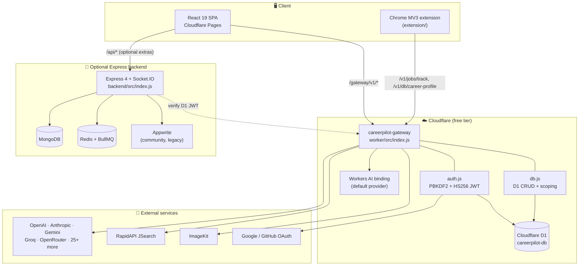
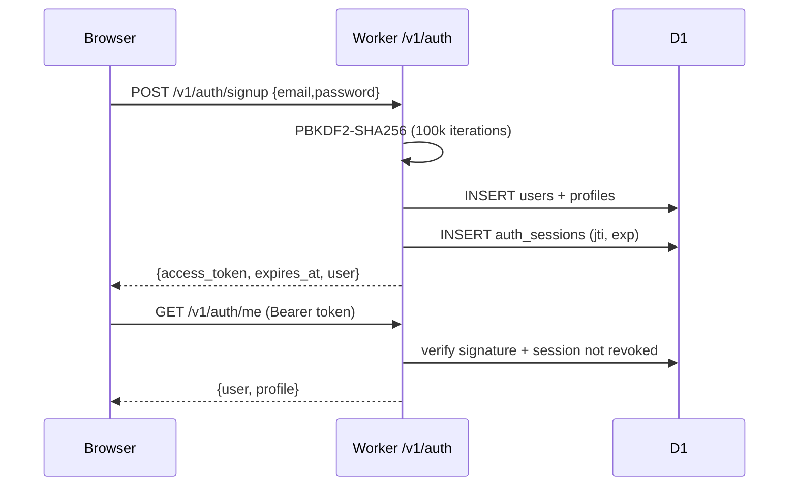
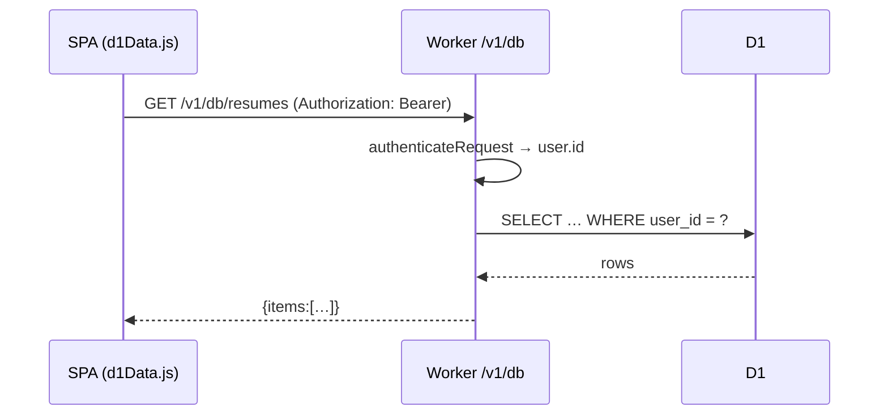
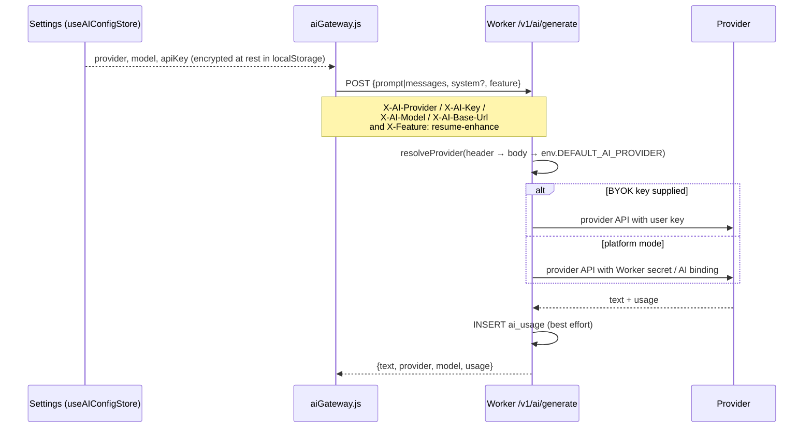
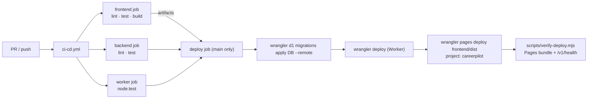

# 🏗️ System Architecture

<div align="center">

**Career Pilot — technical architecture**

*Last updated: 2026-11-28. This document describes the code as it exists in
`main`. If a claim here disagrees with the source, the source wins — please open
a PR against this file.*

</div>

---

## 📋 Table of Contents

- [High-Level Architecture](#-high-level-architecture)
- [System Components](#-system-components)
- [Request Flows](#-request-flows)
- [Authentication & Authorization](#-authentication--authorization)
- [AI Pipeline](#-ai-pipeline)
- [Data Layer](#-data-layer)
- [API Architecture](#-api-architecture)
- [Frontend Architecture](#-frontend-architecture)
- [Security Architecture](#-security-architecture)
- [Deployment Architecture](#-deployment-architecture)
- [Scalability & Limits](#-scalability--limits)
- [Legacy Components](#-legacy-components)

---

## 🎯 High-Level Architecture

Career Pilot ships as a static React SPA on **Cloudflare Pages**, with identity,
CRUD, AI provider routing, job search and uploads in a single **Cloudflare
Worker** (`worker/`) backed by **Cloudflare D1**. An **optional Express
backend** (`backend/`) still hosts the feature-specific AI endpoints (resume
enhance, interview AI, roast, cover-letter/LinkedIn generation), PDF rendering,
portfolio deploys, community and queues.



**Design rules**

1. **One gateway** — the browser talks to one base URL (`VITE_AI_GATEWAY_URL`,
   default `/gateway/v1`) for identity, data and AI.
2. **One auth** — D1-native accounts and sessions; the Express backend accepts
   the same bearer token (`verifyD1Token`) and falls back to Supabase/Clerk only
   for legacy deployments.
3. **One AI config at the edge** — gateway-routed generation uses a single
   client (`frontend/src/services/aiGateway.js`) and a single Worker provider
   registry with per-request BYOK overrides. The legacy Express feature
   endpoints keep their own registry until they are ported.
4. **Static-first** — the SPA is fully static; no server-side rendering, no
   Node runtime needed for the core loop.
5. **Optional backend** — anything requiring Node (feature-specific AI prompts,
   PDF rendering, portfolio deploys, queues, community) lives behind `/api` and
   can be self-hosted or omitted. The SPA degrades to the D1/AI-router features
   when it is absent; those buttons surface API errors.

---

## 🧩 System Components

| Component | Path | Runtime | Responsibility |
|---|---|---|---|
| SPA | `frontend/` | Browser | UI, routing, client-side PDF extraction, AI/CRUD calls |
| Portfolio shell | `frontend/standalone/`, `vite.standalone.config.js` | Build-time | Builds `dist-portfolio/standalone.html` used by backend deploy |
| Gateway Worker | `worker/src/index.js` | Cloudflare Workers | Router, CORS, rate limits, AI router, jobs, ImageKit, health |
| Auth module | `worker/src/auth.js` | Cloudflare Workers | Signup/login/logout, JWT issue/verify, sessions, OAuth, D1 scoping helper |
| D1 module | `worker/src/db.js` | Cloudflare Workers | CRUD for every platform table with per-user scoping and public share reads |
| D1 schema | `worker/migrations/` | Cloudflare D1 | `0001_initial_schema.sql`, `0002_unified_d1_platform.sql` |
| Express API | `backend/src/index.js` | Node 22 | Resume PDF render, portfolio deploy, GitHub intel, community, fellowship, payments, admin, queues |
| Extension | `extension/` | Chrome MV3 | One-click track a job listing, score against career profile |
| Deploy smoke test | `scripts/verify-deploy.mjs` | Node | Verifies Pages serves the new bundle and Worker `/v1/health` is ready |

### Cloudflare bindings (`worker/wrangler.toml`)

| Binding | Type | Notes |
|---|---|---|
| `DB` | D1 database | `careerpilot-db` (`54d97544-…`), migrations in `worker/migrations` |
| `AI` | Workers AI | Default provider when no BYOK key is supplied |
| `ALLOWED_ORIGINS` | var | `*` today; tighten per environment |
| `DEFAULT_AI_PROVIDER` | var | `cloudflare` |
| `CLOUDFLARE_ACCOUNT_ID` | var | Used for the Workers AI REST path and live model listing |
| `IMAGEKIT_PUBLIC_KEY`, `IMAGEKIT_URL_ENDPOINT` | var | Public ImageKit config |

Secrets (`npx wrangler secret put …`): `AUTH_SECRET`, `CLOUDFLARE_API_TOKEN`,
`GEMINI_API_KEY`, `OPENAI_API_KEY`, `GROQ_API_KEY`, `OPENROUTER_API_KEY`,
`ANTHROPIC_API_KEY`, `RAPIDAPI_KEY`, `IMAGEKIT_PRIVATE_KEY`, plus optional
`GOOGLE_CLIENT_ID`/`GOOGLE_CLIENT_SECRET` and
`GITHUB_CLIENT_ID`/`GITHUB_CLIENT_SECRET` for OAuth.

---

## 🔄 Request Flows

### 1. Signup / login



- Tokens are HS256 JWTs with a 7-day TTL (`TOKEN_TTL_SECONDS`), signed with
  `AUTH_SECRET` (falls back to `JWT_SECRET`, then `CLOUDFLARE_API_TOKEN` in
  non-production).
- Every token has a `jti` stored in `auth_sessions`; logout revokes the row and
  verification checks `revoked`/`expires_at`.
- OAuth: `GET /v1/auth/oauth/:provider` creates a state row (10-minute TTL) and
  redirects; the callback exchanges the code, upserts the user, issues a token
  and redirects to the frontend `/auth/callback`.
- The SPA stores the session in `localStorage` under
  `careerpilot:d1:session` (`frontend/src/config/d1.js`) and notifies
  subscribers through `onAuthStateChange`.

### 2. Authenticated CRUD



- `worker/src/auth.js#authenticateRequest` resolves the bearer token to a user
  and, for public resources (shared resumes, public portfolios, roast share
  links), `db.js` allows anonymous reads by `share_token`/`slug`.
- All list/update/delete statements add `user_id = ?` to the WHERE clause.
  Multi-tenant scoping is covered by worker tests.
- The frontend facade is `frontend/src/services/api.js`, which delegates core
  tools to `frontend/src/services/d1Data.js`. Tools that still need Node go to
  `/api` through the same facade.

### 3. AI generation



### 4. Job search and extension tracking

- `POST /v1/jobs/search` proxies RapidAPI JSearch (`jsearch.p.rapidapi.com`)
  with `RAPIDAPI_KEY`; returns 503 if unconfigured.
- `POST /v1/jobs/track` authenticates the D1 JWT (the extension stores a token
  the user pastes in its settings), computes an idempotency key
  (`company::title` or `jobId`), and inserts into `tracked_jobs` with
  `source: "extension"`. Repeats return `alreadyTracked: true`.
- The extension also calls `GET/PUT /v1/db/career-profile` to score listings
  against the master profile before saving.

### 5. Uploads

- `GET /v1/imagekit/auth` returns a short-lived HMAC-SHA1 signature (30 min)
  for direct browser-to-ImageKit uploads.
- `POST /v1/imagekit/upload` accepts multipart or JSON/base64 (≤10 MB) and
  forwards to ImageKit with the private key server-side.
- Uploaded file metadata can be recorded in the D1 `files` table.

### 6. Portfolio build and deploy

```text
Template (React, frontend/src/components/portfolio/templates/*/index.jsx)
  → PortfolioContext.usePortfolio() supplies content
  → standalone bundle: frontend/vite.standalone.config.js
      → frontend/dist-portfolio/standalone.html
  → Express POST /api/portfolio/deploy (backend) builds the HTML bundle
  → backend/src/services/deploy/{cloudflare,netlify,githubPages}Deployer.js
  → deployed URL recorded in D1 portfolio_deployments (via gateway)
```

The 262 portfolio templates are discovered from the filesystem by
`frontend/src/data/portfolioTemplates.jsx` (`import.meta.glob`), so adding a
directory is enough to appear in the gallery and standalone bundle.

---

## 🔐 Authentication & Authorization

| Concern | Implementation |
|---|---|
| Password storage | `pbkdf2$100000$salt$hash` (PBKDF2-SHA256, 16-byte salt, 256-bit output) |
| Session token | HS256 JWT, 7-day TTL, `jti` persisted in `auth_sessions` |
| Revocation | `auth_sessions.revoked = 1` on logout; verify rejects revoked/expired |
| OAuth | Google and GitHub authorization-code flow; `oauth_states` rows expire after 10 minutes |
| Identity source | D1 `users` table (`password_hash`, `auth_provider`, `provider_id`, `is_admin`) |
| Authorization | Every D1 query scoped by `user_id`; public reads only via `share_token`, public portfolio `slug`, or `is_public` |
| Admin | `users.is_admin` in D1; Express `adminOnly` middleware reads `ADMIN_EMAILS`/`ADMIN_UIDS` |
| Legacy fallback | Express auth also accepts Supabase bearer tokens and Clerk sessions when configured |

The old Firebase/Clerk/Appwrite identity paths are **not** used by the D1 core.
The frontend ships `config/supabase.js` and `config/appwrite.js` only for
legacy modules (Appwrite avatar upload); the AuthProvider uses `d1Auth`.

---

## 🧠 AI Pipeline

### Provider resolution order

1. `X-AI-Provider`, `X-AI-Key`, `X-AI-Model`, `X-AI-Base-Url` headers (BYOK)
2. Body fields `provider`, `apiKey`, `model`, `baseUrl`
3. `env.DEFAULT_AI_PROVIDER` (default `cloudflare`)
4. Model defaults from `DEFAULT_MODELS`

Provider ids are normalised (`claude` → `anthropic`, `google` → `gemini`,
`openai-compatible` → `custom`).

### Provider registry

| Path | Providers |
|---|---|
| Native Cloudflare binding | `cloudflare` (Workers AI: Llama 3.1/3.3, DeepSeek R1 distil, Mistral, Qwen) |
| Native APIs | `gemini` (`generateContent`), `anthropic` (`/v1/messages`) |
| OpenAI-compatible registry (26) | `openai`, `groq`, `openrouter`, `requesty`, `deepseek`, `mistral`, `xai`, `together`, `fireworks`, `perplexity`, `cohere`, `cerebras`, `sambanova`, `hyperbolic`, `novita`, `moonshot`, `zhipu`, `dashscope`, `nebius`, `chutes`, `github`, `ollama`, `lmstudio`, `vllm`, `llamacpp`, `azure` |
| Custom | `custom` (user-supplied `baseUrl`) |

The frontend catalog (`PROVIDER_META` in
`frontend/src/stores/useAIConfigStore.js`) exposes **30 providers** including
keyless local runtimes (Ollama, LM Studio, vLLM, llama.cpp). The worker registry
and the frontend catalog must stay in sync when adding a provider.

### Endpoints

| Endpoint | Purpose |
|---|---|
| `POST /v1/ai/generate` | Chat/completion. Accepts `prompt` or `messages[]` + optional `system`; returns `{text, provider, model, usage}` |
| `POST /v1/ai/validate-key` | Validates a provider key against the provider API |
| `GET/POST /v1/ai/models` | Live model discovery with static catalog fallback |

Modes:

- **Platform mode (default)** — Worker secrets (or the `AI` binding) supply the
  key. This is what ships on the free tier.
- **BYOK mode** — the key travels in `X-AI-Key` per request; it is never stored
  server-side. The frontend encrypts keys in `localStorage` via
  `useAIConfigStore`.

Every successful **gateway** call is logged fire-and-forget to `ai_usage`
(`user_id`, `feature` from `X-Feature`, provider, model, tokens, latency,
`byok`). Express feature endpoints do not write this ledger yet. Gateway
failures return `502` with the provider error message.

---

## 🗄️ Data Layer

### D1 is the primary store

Tables created by `worker/migrations/0002_unified_d1_platform.sql` (plus the
five base tables from `0001`):

| Domain | Tables |
|---|---|
| Identity | `users`, `profiles`, `auth_sessions`, `oauth_states` |
| Resumes | `resumes`, `resume_versions`, `resume_ats_history`, `resume_roasts`, `cover_letters` |
| Jobs | `tracked_jobs`, `job_listings`, `job_alerts` |
| Portfolios | `portfolios`, `portfolio_deployments`, `github_portfolio_builds` |
| Interviews | `interviews`, `interview_answers` |
| Career | `career_profiles`, `star_stories`, `outreach_records` |
| Platform | `notifications`, `user_settings`, `ai_usage`, `files`, `user_inputs`, `recruiter_analysis` |
| Community (schema present) | `community_posts`, `community_comments` |

Conventions:

- Timestamps are ISO-8601 text (`datetime('now')`); ids are UUID strings.
- Tool-specific documents are stored verbatim in `data TEXT DEFAULT '{}'`
  columns, so existing camelCase field names keep working.
- Indexes cover the common access paths (`user_id`, `updated_at DESC`, status,
  `next_action_at`, `tracked_job_id`).

See [docs/DATABASE_SCHEMA.md](docs/DATABASE_SCHEMA.md) for every column.

### Legacy stores

| Store | Status | Used by |
|---|---|---|
| Supabase Postgres | Legacy | `supabase/migrations/*.sql`; Express auth fallback; not called by the SPA core |
| MongoDB | Legacy | Express backend models (resume PDF pipeline, community, payments, admin) |
| Appwrite | Legacy | Express community controller and the frontend avatar helper |
| Redis | Optional | Express queues (BullMQ), cache, Socket.IO adapter |
| Firebase | Removed | `firebase/` files remain only as historical artifacts |

---

## 🌐 API Architecture

### Gateway Worker (primary)

All paths are served with or without the `/gateway` prefix (the router strips
it). Auth routes: `/v1/auth/*`; data routes: `/v1/db/*`; AI: `/v1/ai/*`;
utility: `/v1/jobs/*`, `/v1/imagekit/*`, `/v1/health`.

Full reference: [API_DOCS/gateway.md](API_DOCS/gateway.md). The main groups:

| Group | Examples |
|---|---|
| Auth | `POST /v1/auth/signup`, `POST /v1/auth/login`, `POST /v1/auth/logout`, `GET /v1/auth/me`, `POST /v1/auth/refresh`, `GET /v1/auth/providers`, `GET /v1/auth/oauth/{google,github}` |
| Profiles/settings | `/v1/db/profiles/me`, `/v1/db/profiles/:uid`, `/v1/db/profiles/:uid/stats`, `/v1/db/settings` |
| Resumes | `/v1/db/resumes`, `/v1/db/resumes/:id`, `/versions`, `/ats-history`, `/share/:token` |
| Jobs | `/v1/db/jobs`, `/v1/db/jobs/:id/status`, `/v1/db/alerts`, `/v1/db/job-listings` |
| Portfolios | `/v1/db/portfolios`, `/v1/db/portfolio-deployments` |
| Career | `/v1/db/career-profile`, `/v1/db/star-stories` |
| Interviews | `/v1/db/interviews`, `/v1/db/interviews/:id/answers` |
| Other | `/v1/db/roasts`, `/v1/db/cover-letters`, `/v1/db/notifications`, `/v1/db/github-builds`, `/v1/db/outreach`, `/v1/db/user-inputs`, `/v1/db/recruiter-analysis`, `/v1/db/ai-usage` |

### Express backend (optional)

Mounted under `/api` in `backend/src/index.js`:

```text
/api/webhooks  /api/docs  /api/auth  /api/upload  /api/resumes
/api/enhance   /api/roast  /api/fetchjobs  /api/salary
/api/job-tracker  /api/jobs  /api/career-profile  /api/job-alerts
/api/community  /api/fellowship  /api/interview  /api/payments
/api/collaboration  /api/portfolio  /api/portfolio/github
/api/user-profiles  /api/gdpr  /api/auth/2fa  /api/search  /api/ai
/api/email-tracking  /api/analyzer  /api/readme-generator
/api/project-visualizer  /api/subscription  /api/admin  /api/admin/queues
```

Route inventory and request/response examples live in `API_DOCS/`.

### Error contract

- Gateway: `{ "error": "message" }` with 400/401/403/404/429/500/502/503.
- Express: `{ "success": false, "error": "message" }` through
  `globalErrorHandler.js`; validation errors are 400 with `details`.

---

## 🖥️ Frontend Architecture

| Concern | Implementation |
|---|---|
| Routing | React Router 7 (`frontend/src/App.jsx`); public tool landings, protected tools, hubs (`/hub/*`), nested fellowship routes, admin (`/admin/*`) |
| Auth state | `context/AuthProvider.jsx` → `config/d1.js` (`d1Auth`, `onAuthStateChange`) |
| Data | `services/api.js` facade → `services/d1Data.js` (core) or `fetch('/api/…')` (extras) |
| AI | `services/aiGateway.js` → `/gateway/v1/ai/*` |
| Uploads | `services/imagekit.js` → gateway signature + direct ImageKit upload |
| PDF text extraction | `utils/pdfExtract.js` (pdfjs-dist), client-side |
| PDF generation | `services/atsPdfExport.js`, jsPDF/html2canvas |
| State | Context providers + Zustand (`useAIConfigStore`, `useGithubConfigStore`, …) |
| PWA | `vite-plugin-pwa` + `pwaOptions.js` |
| Templates | `components/resume/templates/` (60), `components/portfolio/templates/` (262), registry from `data/portfolioTemplates.jsx` |

Protected pages render only after `AuthProvider` resolves the D1 session;
`ProtectedRoute` redirects to `/login`. Public share routes (`/shared/:shareToken`,
`/roast/:shareToken`, public portfolio slugs) render without a session.

---

## 🔒 Security Architecture

| Layer | Control |
|---|---|
| Passwords | PBKDF2-SHA256, 100k iterations, random 16-byte salt, constant-time comparison |
| Tokens | HS256 JWT, 7-day TTL, `jti` session row, revocation on logout |
| OAuth state | Single-use `oauth_states` row, 10-minute expiry |
| Tenant isolation | `user_id` predicate on every D1 read/write; public access only by explicit share token/slug |
| CORS | `ALLOWED_ORIGINS` (currently `*`; set an explicit origin list in production) |
| Rate limiting | 240 req/min per IP globally, 20 req/min for AI generation (in-memory, per isolate) |
| Headers | Worker JSON responses set `X-Content-Type-Options: nosniff` and `X-Frame-Options: DENY`; Pages `_headers` sets frame, referrer and permission policies |
| Secrets | Wrangler secrets only; no provider keys in the browser bundle in platform mode |
| BYOK | Keys encrypted in `localStorage`, sent per request, never persisted server-side |
| Input handling | JSON parsing with typed checks; uploads capped at 10 MB; Express adds Helmet, CSP, sanitizers, Zod/Joi validation |
| Payments | Razorpay HMAC signature verification (Express) |

Known gaps to address before a public launch: tighten `ALLOWED_ORIGINS`,
replace the in-memory rate limiter with a Durable Object/KV counter for
cross-isolate enforcement, add email verification/password reset, and remove the
anonymous portfolio-slug fallback in `worker/src/db.js` (it currently returns a
non-public portfolio when no `is_public=1` row matches).

---

## 🚢 Deployment Architecture



| Workflow | Trigger | What it does |
|---|---|---|
| `.github/workflows/ci-cd.yml` | PR, push to `main`, manual | 3 CI jobs; on green `main` run: D1 migrations → Worker deploy → Pages deploy → smoke test |
| `.github/workflows/security.yml` | PR, push, weekly cron | Dependency review (blocks high severity), OSV SARIF scan |
| `.github/workflows/release.yml` | push to `main` | semantic-release: tags, `CHANGELOG.md`, GitHub release |
| `.github/dependabot.yml` | weekly | Grouped npm + Actions updates |

Required secrets: `CLOUDFLARE_API_TOKEN` (Workers Scripts: Edit, Pages: Edit,
D1: Edit) and `CLOUDFLARE_ACCOUNT_ID`. Optional variables: `PAGES_URL`,
`WORKER_URL`, `PUBLIC_SITE_URL` (used by the smoke test and summary).

Node version is pinned to 22 (`.nvmrc` and `NODE_VERSION` in CI). The backend
is built and tested but **not deployed** by this pipeline.

---

## 📈 Scalability & Limits

| Resource | Free-tier limit | Implication |
|---|---|---|
| Pages | Unlimited static requests | SPA scales at the edge |
| Workers | 100k requests/day | Gateway calls (auth/CRUD/AI) consume this budget |
| Workers AI | Neuron allocation | Default provider is free but rate-limited |
| D1 | 5 GB storage, 5M row reads/day | Plenty for early users; JSON blobs keep row counts low |
| Rate limiting | Per-isolate memory | Not globally exact; acceptable for abuse damping |
| AI | 20 req/min/IP | Client should debounce generate calls |

Scaling path: move rate limiting to Durable Objects, add Cloudflare Cron
Triggers for alerts/digests, and put a KV cache in front of hot read endpoints.
The Express backend scales horizontally behind a load balancer with Redis for
shared queues/sockets.

---

## 🧱 Legacy Components

These remain in the tree and are documented so contributors do not mistake them
for the live path:

- **Supabase** — `supabase/migrations/*.sql` predates D1. The Supabase JS client
  remains in `frontend/src/config/supabase.js` and the Express fallback auth.
- **MongoDB/Mongoose** — the Express backend's primary store for features that
  still run there (models in `backend/src/models/`).
- **Appwrite** — community controller in the Express backend and
  `frontend/src/utils/avatarUpload.js`.
- **Clerk** — optional Express auth fallback (`@clerk/express`).
- **Firebase** — `firebase/` rules and indexes are historical; there is no
  Firebase Admin dependency in `backend/package.json`.
- **Socket.IO / BullMQ / Redis** — realtime and background work for the Express
  path only; the Cloudflare core is request/response.

Migration direction: port remaining Express-only features to the gateway (see
the phase-2 list in [docs/UNIFIED_PLATFORM.md](docs/UNIFIED_PLATFORM.md)), then
retire the legacy stores.
