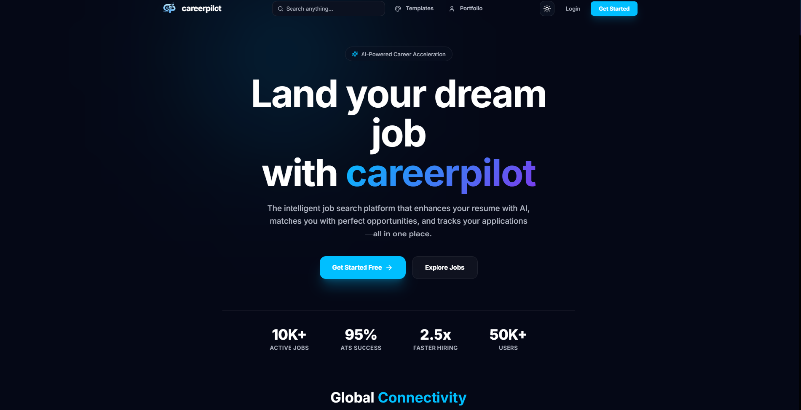
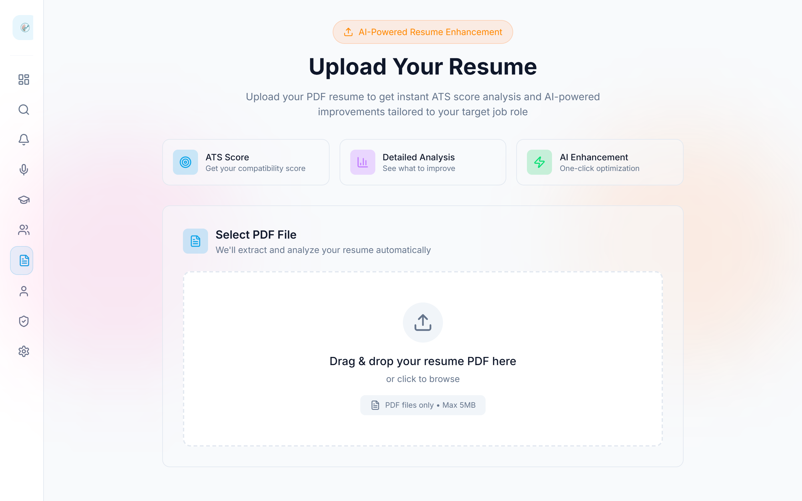
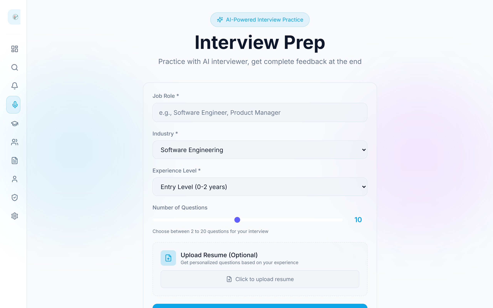
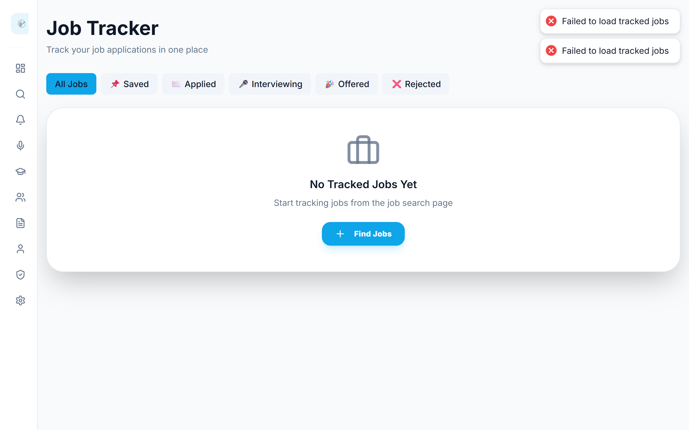
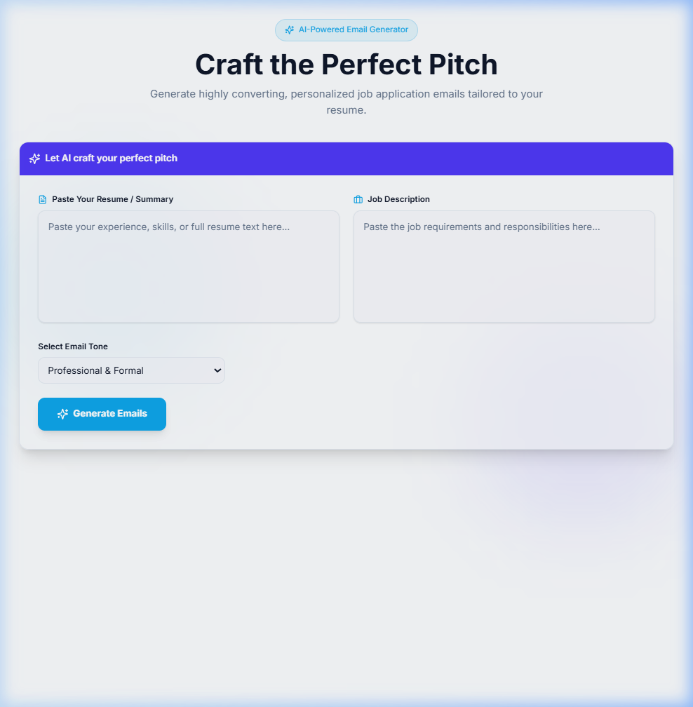
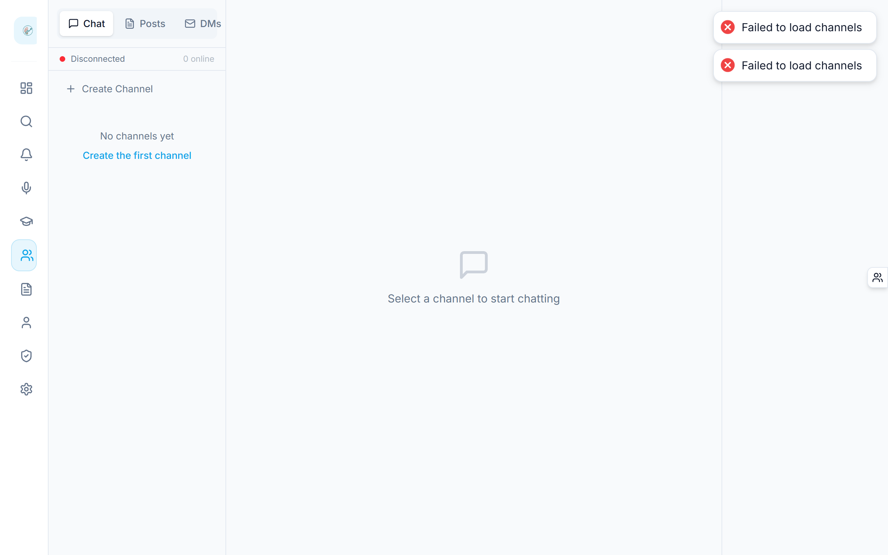

<div align="center">
  <p></p>
  <h1>Career Pilot</h1>
  <p><strong>AI-powered career OS — resumes, mock interviews, job tracking, portfolios, fellowships, GitHub intelligence and outreach, all in one full-stack platform.</strong></p>
  <p>
    <a href="https://github.com/anurag3407/career-pilot/stargazers"></a>
    <a href="https://github.com/anurag3407/career-pilot/blob/main/LICENSE"></a>
    <a href="#-quick-install"></a>
  </p>
  <p>
    
    
    
    
    
    
    
    
    
    
    
  </p>
  <p>
    Documentation · <a href="https://discord.gg/dpDMVywS">Discord</a> · License: <a href="LICENSE">MIT</a> · Built with ❤️ by the Career Pilot community
  </p>
</div>

---

## **Website & Autofill Extension**

[](https://app.zapply.jobs/onboarding?ref=github-cta-anurag3407)

Explore Zapply’s website and check out:

- Our Chrome extension, which autofills job applications in seconds.
- A dedicated job board featuring the latest openings across various roles.
- User accounts with multiple profiles for different resume types and roles.
- Job application tracking with streaks and commitment awards.
Experience an advanced career journey with us! 🚀
<p align="center">
<a href="https://app.zapply.jobs/onboarding?ref=github-cta-anurag3407">

</a>
</p>
<p align="right"><sub>Sponsored by Zapply</sub></p>

---

## Table of Contents

- [✨ What is Career Pilot?](#-what-is-career-pilot)
- [🔄 How It Works](#-how-it-works)
- [📸 Screenshots](#-screenshots)
- [📂 Project Structure](#-project-structure)
- [🧭 Feature Pillars](#-feature-pillars)
- [🚀 Quick Install](#-quick-install)
- [🔑 Environment Variables](#-environment-variables)
- [🏁 Getting Started](#-getting-started)
- [📝 Pillar 1 — Resume Studio](#-pillar-1--resume-studio)
- [🎤 Pillar 2 — Interview Sim](#-pillar-2--interview-sim)
- [💼 Pillar 3 — Jobs & Tracker](#-pillar-3--jobs--tracker)
- [🎨 Pillar 4 — Portfolio Studio](#-pillar-4--portfolio-studio)
- [🧠 Pillar 5 — AI Career Tools](#-pillar-5--ai-career-tools)
- [🌐 Pillar 6 — Community, Fellowships & GitHub Intel](#-pillar-6--community-fellowships--github-intel)
- [🔐 Security, Auth & Privacy](#-security-auth--privacy)
- [🧩 Architecture at a Glance](#-architecture-at-a-glance)
- [🌐 Real-time, Queues & Background Work](#-real-time-queues--background-work)
- [🛠 CLI vs Web Quick Reference](#-cli-vs-web-quick-reference)
- [📚 Documentation](#-documentation)
- [🧪 Testing](#-testing)
- [🚢 Deployment](#-deployment)
- [🔄 Migrating from Other Tools](#-migrating-from-other-tools)
- [🛣 Roadmap](#-roadmap)
- [🧠 Project Notes](#-project-notes)
- [🤝 Contributing](#-contributing)
- [👥 Maintainers](#-maintainers)
- [💬 Community](#-community)
- [📄 License](#-license)

---

## ✨ What is Career Pilot?

**Career Pilot** is a full-stack, AI-first **career operating system** that turns job hunting from a chaotic, multi-tab slog into a single workflow. It's not a single-purpose resume builder — it's a unified platform that combines **resumes, mock interviews, job search & tracking, portfolio publishing, GitHub intelligence, fellowships, paid challenges, community, outreach, and admin tooling** behind one authenticated dashboard.

Powered by **30 AI providers** (Cloudflare Workers AI by default, plus OpenAI, Anthropic Claude, Google Gemini, Groq, OpenRouter, DeepSeek, Mistral and a Bring-Your-Own-Key path), Career Pilot writes your resume, critiques it like an ATS, runs you through mock interviews with an avatar, tracks every job application on a kanban board, deploys a designer-grade portfolio to Netlify / Cloudflare Pages / GitHub Pages, parses your GitHub for risk and impact, and emails recruiters on your behalf — from a React SPA on **Cloudflare Pages** backed by a **Cloudflare Worker + D1** gateway.

It's modular by design: the gateway Worker owns auth, D1 CRUD, AI provider routing, job search and ImageKit uploads; an optional Express backend covers feature-specific AI endpoints (resume enhance, mock-interview AI, roast, cover-letter/LinkedIn generation), PDF rendering, portfolio deploys, community and queues. The React frontend has 50+ pages across feature hubs, 60 resume templates and 262 portfolio templates, and contributors can pick up **good-first-issue** tickets in any one of them without having to grok the rest of the system.

---

## 🔄 How It Works

Career Pilot guides users through their complete career journey:

1. Sign up or log in securely.
2. Build or import your resume.
3. Enhance it using AI and ATS optimization.
4. Practice mock interviews with AI.
5. Search and track job applications.
6. Build and deploy your portfolio.
7. Analyze GitHub repositories and improve your profile.
8. Connect with the community and participate in fellowships.

## 📸 Screenshots

| Home Page | Resume Enhancer |
|-----------|-----------------|
|  |  |

| Mock Interview | Job Tracker |
|----------------|-------------|
|  |  |

| Email Generator | Community Board |
|-----------------|-----------------|
|  |  |

## 📂 Project Structure

```text
career-pilot/
├── frontend/         # React 19 + Vite 7 SPA (Pages project "careerpilot")
├── worker/           # Cloudflare Worker gateway: native auth, D1 CRUD, AI router,
│                     # RapidAPI job search, ImageKit uploads (wrangler.toml)
├── backend/          # Optional Express 4 API: AI feature endpoints + extras (Mongo/Redis)
├── extension/        # Chrome Manifest V3 job-tracker extension
├── supabase/         # Legacy Supabase migrations (pre-D1, kept for existing deploys)
├── docs/             # Architecture, setup, feature and schema documentation
├── API_DOCS/         # Gateway + Express API reference
├── scripts/          # verify-deploy.mjs and gateway smoke checks
├── .github/          # ci-cd.yml, security.yml, release.yml, dependabot.yml
├── docker-compose.yml
└── README.md
```

For a detailed architecture overview, see the **Architecture at a Glance** section below.

## 🧭 Feature Pillars

Career Pilot is organized into six tightly-integrated pillars. Each pillar ships its own UI hub, gateway/Express routes, AI services, and D1 tables (where applicable) — and they share authentication, notifications, and rate limiting.

| | Pillar | What you get |
|---|---|---|
| 📝 | **Resume Studio** | AI-built resumes, 60 templates, ATS scorer, drag-and-drop sections, text-to-resume, tailoring, translation, versions & sharing |
| 🎤 | **Interview Sim** | Audio + video mock interviews with an avatar interviewer, coding round (Monaco editor, executed against hidden tests), 14 languages, confidence meter, replay |
| 💼 | **Jobs & Tracker** | JSearch-powered search, drag-and-drop kanban tracker, scheduled email alerts, company research, JD summarizer, recruiter outreach & tracking |
| 🎨 | **Portfolio Studio** | 262 deployable themes, AI extractor, section content editor, deploy to Netlify / Cloudflare / GitHub Pages, accessibility audit, versioning |
| 🧠 | **AI Career Tools** | Cover-letter generator, email drafter (3 variants), LinkedIn optimizer, skill-gap analyzer, career-trajectory predictor, weekly digest |
| 🌐 | **Community, Fellowships & GitHub Intel** | Channels, posts, DMs, scheduled posts, paid fellowship challenges, Razorpay payouts, repo analyzer, project visualizer, CI/CD & dependency detection |

---

## 🚀 Quick Install

### Prerequisites
- **Node.js 22+** and **npm 10+** (see `.nvmrc`)
- **Cloudflare account** (free tier) for Pages, Workers and D1 — or run the gateway locally with `wrangler dev`
- Optional, only for the Express feature endpoints/extras (AI enhance, interview AI, PDF, portfolio deploy, community): **MongoDB 6.0+** and **Redis 7.0+**
- Optional integrations: **Cloudflare Workers AI / OpenAI / Anthropic / Gemini / Groq** keys (platform mode ships with a Cloudflare binding), **RapidAPI** for JSearch, **ImageKit** for uploads, **Razorpay** for fellowship payments, **GitHub OAuth app** for repo features

### Clone & bootstrap
```bash
git clone https://github.com/anurag3407/career-pilot.git
cd career-pilot

# Root + frontend + backend deps
npm run install:all

# Gateway Worker deps (not covered by install:all)
npm --prefix worker install
```

### Configure environment

```bash
# Frontend
cp frontend/.env.example frontend/.env
# Defaults work for local dev: VITE_AI_GATEWAY_URL=/gateway/v1 (vite proxies to :8787)

# Gateway Worker — apply the schema to the local D1
cd worker
npx wrangler d1 migrations apply DB --local
# Production secrets are set at deploy time, not for local dev:
#   npx wrangler secret put AUTH_SECRET
#   npx wrangler secret put GEMINI_API_KEY   # optional
#   npx wrangler secret put RAPIDAPI_KEY     # optional
#   npx wrangler secret put IMAGEKIT_PRIVATE_KEY

# Optional Express backend (from the repo root)
cd ..
cp backend/.env.example backend/.env
# Edit backend/.env — MONGODB_URI, REDIS_URL, FRONTEND_URL, CLOUDFLARE_D1_GATEWAY_URL
```

## 🔑 Environment Variables

The live stack has three configuration surfaces: the **frontend** (build-time
`VITE_*`), the **gateway Worker** (`wrangler.toml` vars + secrets), and the
**optional Express backend**.

### Frontend Environment Variables

| Category | Important Variables |
|----------|---------------------|
| Gateway | `VITE_AI_GATEWAY_URL` (default `/gateway/v1`) |
| Backend API | `VITE_API_URL`, `VITE_API_BASE` (only if self-hosting Express) |
| Dev proxies | `VITE_AI_GATEWAY_DEV_URL` (default `http://localhost:8787`) |
| Assets/CDN | `VITE_CDN_URL` (Vite base, default `/`) |
| Feature Flags | `VITE_DISABLE_D1_AUTH` (preview mode) |

> Refer to `frontend/.env.example` for the complete list. Auth, profiles,
> resumes, jobs, alerts, portfolios and settings go through the gateway; no
> Supabase/Clerk/Appwrite keys are needed for the core loop.

### Gateway Worker Variables

| Category | Important Variables |
|----------|---------------------|
| Bindings | `DB` (D1), `AI` (Workers AI) — declared in `worker/wrangler.toml` |
| Vars | `ALLOWED_ORIGINS`, `DEFAULT_AI_PROVIDER`, `CLOUDFLARE_ACCOUNT_ID`, `IMAGEKIT_PUBLIC_KEY`, `IMAGEKIT_URL_ENDPOINT` |
| Secrets | `AUTH_SECRET`, `CLOUDFLARE_API_TOKEN`, `GEMINI_API_KEY`, `OPENAI_API_KEY`, `GROQ_API_KEY`, `OPENROUTER_API_KEY`, `ANTHROPIC_API_KEY`, `RAPIDAPI_KEY`, `IMAGEKIT_PRIVATE_KEY` |
| OAuth (optional) | `GOOGLE_CLIENT_ID`/`GOOGLE_CLIENT_SECRET`, `GITHUB_CLIENT_ID`/`GITHUB_CLIENT_SECRET` |

> Set secrets with `npx wrangler secret put <NAME>` from `worker/`. See
> [docs/environment-setup.md](docs/environment-setup.md) for the full matrix.

### Backend Environment Variables (optional)

| Category | Important Variables |
|----------|---------------------|
| Server | `PORT`, `NODE_ENV`, `FRONTEND_URL` |
| Database | `MONGODB_URI` (legacy extras) |
| D1 bridge | `CLOUDFLARE_D1_GATEWAY_URL`, `AUTH_SECRET` |
| Supabase (legacy fallback) | `SUPABASE_URL`, `SUPABASE_SERVICE_ROLE_KEY` |
| Appwrite (legacy community) | `APPWRITE_ENDPOINT`, `APPWRITE_PROJECT_ID`, `APPWRITE_API_KEY` |
| AI Services | `GEMINI_API_KEY`, `OPENAI_API_KEY`, `GROQ_API_KEY`, `AI_PROVIDER` |
| Job Search | `RAPIDAPI_KEY`, `RAPIDAPI_HOST` |
| Email | `EMAIL_USER`, `EMAIL_PASS`, `EMAIL_HOST`, `EMAIL_PORT` |
| Redis | `REDIS_URL` |
| Payments | `RAZORPAY_KEY_ID`, `RAZORPAY_KEY_SECRET` |
| OAuth | `LINKEDIN_CLIENT_ID`, `LINKEDIN_CLIENT_SECRET`, `GITHUB_CLIENT_ID`, `GITHUB_CLIENT_SECRET` |
| Deployment | `NETLIFY_ACCESS_TOKEN`, `VERCEL_TOKEN`, `CLOUDFLARE_API_TOKEN` |
| Security | `ENCRYPTION_KEY`, `TOTP_ENCRYPTION_KEY` |

> Refer to `backend/.env.example` for the complete list of backend environment variables and descriptions.

### Run locally

```bash
# Terminal 1 — gateway Worker (D1 + auth + AI, http://localhost:8787)
cd worker
npx wrangler dev

# Terminal 2 — frontend (Vite on :5173, proxies /gateway → :8787)
cd frontend
npm run dev

# Terminal 3 (optional) — Express backend on :5000 for self-hosted extras
cd backend
npm run dev
```

Visit **http://localhost:5173** and sign up. Accounts are stored in D1 with
PBKDF2-hashed passwords and HS256 session tokens; Google/GitHub OAuth works when
the Worker has the provider secrets.

With only the Worker running, auth/CRUD, the generic AI router and job search
work. Feature endpoints that still live in Express (`/api/enhance`,
`/api/interview`, `/api/roast`, `/api/cover-letter`, README/LinkedIn tools,
portfolio deploy) need the optional backend on `:5000`.

### Docker (one command)

```bash
docker compose up --build
```

The included `docker-compose.yml` is the **legacy self-hosted path**: it builds the frontend and Express backend and starts MongoDB + Redis. The live Cloudflare stack (Pages + Worker + D1) does not use it; run `wrangler dev` for the gateway instead.

---

## 🏁 Getting Started

After installation, the most-used workflows are:

```bash
cd frontend && npm run dev          # http://localhost:5173
# Resume:    /dashboard → "New Resume", or /resume-builder/build
# AI:        /enhance/:resumeId → paste a job description → ATS score + rewrite
# Interview: /mock-interview/practice → pick a role → speak or type answers
# Jobs:      /job-finder/search → "Track" a job → drag across the kanban at /job-tracker
# Portfolio: /templates → pick a theme → /portfolio-builder/studio → Deploy
```

The **Hubs** (`/hub/resume`, `/hub/jobs`, `/hub/portfolio`, `/hub/career`, `/hub/community`) act as mission control — every tool you need for that pillar is one click away.

---

## 📝 Pillar 1 — Resume Studio

A complete resume authoring + analysis environment.

| Feature | Description |
|---|---|
| **Visual Builder** | Step-wizard with sections for Personal, Education, Experience, Projects, Skills, Certifications, Custom Sections. Drag-and-drop reorder with persistence. |
| **60 Templates** | From `ClassicSerif` and `IvyLeague` to `TechMono`, `IDETheme`, `Glassmorphism`, `BrutalistBold`, `NeumorphismSoft`, `PhotoBanner`, `StockholmScandi`, `BerlinTwoCol` — pick the one that matches your industry. |
| **Text-to-Resume** | Paste a wall of text (LinkedIn export, old bio, anything) and the AI structures it into a resume. See `/text-to-resume`. |
| **AI Enhancement** | `Enhance.jsx` runs a multi-pass critique: ATS scoring, achievement rewrites with action verbs, quantified-impact suggestions, tone analyzer, consistency checker. |
| **Resume Tailor** | Paste a job description → AI rewrites your resume to match keywords and rank for that specific role. |
| **Resume Translator** | Translate to 14 languages while preserving layout and section ordering. |
| **ATS Scorer** | Section-aware keyword matching with role dictionaries (software engineer, frontend, backend, data scientist, PM, designer, marketing, sales, HR, PM, etc.). Returns 0–100 with actionable feedback. |
| **Versions & Compare** | Every save snapshots a `ResumeVersion`. Diff two versions side-by-side, restore any prior snapshot. |
| **Sharing & Comments** | Generate a public link (`/shared/:shareToken`) with optional expiry. Reviewers can leave inline comments without an account. |
| **Resume ↔ Portfolio Compare** | Detects drift between your resume claims and your live portfolio content. |
| **PDF Export** | One-click export via `jsPDF` + `html2canvas`, paginated, print-ready. |

**Routes**: `/dashboard`, `/resume-builder`, `/enhance/:resumeId`, `/resume-templates`, `/resume/:resumeId`, `/shared/:shareToken`, `/text-to-resume`

**Backend**: `routes/resume.js`, `routes/enhance.js`, `routes/collaboration.js`, `services/atsScorer.js`, `services/resumeJobMatcher.js`, `services/keywordOptimizer.js`, `services/pdfGenerator.js`

---

## 🎤 Pillar 2 — Interview Sim

A real interview, not a quiz.

| Feature | Description |
|---|---|
| **Avatar Interviewer** | 3D-animated interviewer with idle/active/listening states — built in `AvatarInterviewer.jsx`. |
| **Audio + Video** | Browser mic capture via `VoiceToTextButton`, video toggle, push-to-talk. Falls back gracefully on devices without a camera. |
| **Speech-to-Text** | Server-side transcription pipeline (`transcribeAudio`) uploads buffer to storage and returns text — so any candidate can answer verbally. |
| **Coding Round** | Lazy-loaded **Monaco editor** with syntax highlighting. Code is executed against hidden test cases (`runCodeAgainstTests`) and graded. |
| **14 Languages** | English, Spanish, French, German, Italian, Portuguese, Dutch, Hindi, Japanese, Korean, Simplified Chinese, Arabic, Russian, Turkish — the AI gives feedback and ideal answers in your chosen language. |
| **Company-Specific Bank** | A curated `QuestionBank` model ships pre-vetted questions for top companies. AI generation fills the gaps. |
| **Confidence Meter** | Real-time audio analysis + answer-quality scoring — see how you sound under pressure. |
| **Body Language Tips** | Browser-side heuristics for posture, eye contact, and pace — actionable prompts mid-interview. |
| **Replay** | Every interview is saved (`Interview.model.js`) with question, your answer, ideal answer, and AI analysis. Replay any past attempt in `/interview-history` and `/interview-history/:id`. |
| **JD-Driven Questions** | Drop in a job description URL or paste text — the parser extracts role / level / skills and generates a tailored loop. |
| **Share Cards** | Generate a poster-style image of your interview summary to share on LinkedIn. |

**Routes**: `/mock-interview/practice`, `/interview-history`, `/interview-history/:id`

**Backend**: `routes/interview.js`, `services/interviewService.js`, `services/jdParser.service.js`, `models/Interview.model.js`, `models/QuestionBank.model.js`

---

## 💼 Pillar 3 — Jobs & Tracker

Find, organize, follow up — without losing a single application.

| Feature | Description |
|---|---|
| **Job Search** | Filters for title, location, salary, remote/on-site, recency. Backed by **RapidAPI JSearch** with a multi-source **Scraper Registry** (LinkedIn, Naukri, AngelList, RemoteOK) as a fallback when the API quota is exhausted. |
| **Job Tracker** | Drag-and-drop kanban: `Saved → Applied → Interviewing → Offered → Rejected`. Each card tracks company, role, link, notes, salary, status updates, and timeline. |
| **Mobile Kanban** | Swipe-friendly board for on-the-go status changes (`MobileKanban.jsx`). |
| **Job Alerts** | Define keyword + location + frequency; the gateway stores alerts in D1 and a **BullMQ** worker (Express) runs the query, dedupes, and emails matching roles. (`jobFetcher.js`, `jobAlertQueue.js`) |
| **Smart Email Alerts** | Open + click tracking via `emailTracker.js` + `bounceHandler.js`; unsubscribe links; weekly digest summary. |
| **Company Research** | Paste a company name → AI returns structured intelligence (size, funding, tech stack, culture, recent news) for interview prep. |
| **JD Summarizer** | One-line "what this job actually wants" + responsibility breakdown + must-have vs. nice-to-have skills. |
| **Recruiter Outreach** | `/outreach` — give it a company URL and it drafts 3 personalized cold emails using your resume + the company's open roles, then queues them. |
| **Email Tracking** | Open pixels + click redirects tell you which recruiter actually read your email. |
| **Offline Tolerant** | Status changes are queued locally (`getQueuedStatusUpdates`) and replayed when you're back online — track a job from the train. |

**Routes**: `/job-finder/search`, `/job-tracker`, `/job-alerts`, `/outreach`

**Backend**: `routes/jobsRoute.js`, `routes/jobTracker.js`, `routes/jobAlerts.js`, `routes/outreach.route.js`, `routes/emailTracking.js`, `services/jobFetcher.js`, `services/companyResearchService.js`, `services/jobSummarizer.js`, `services/scrapers/*`, `services/outreachQueue.js`, `services/weeklyDigestService.js`

---

## 🎨 Pillar 4 — Portfolio Studio

A working portfolio site in under a minute — themed, accessible, and live on your hosting provider.

| Feature | Description |
|---|---|
| **262 Deployable Themes** | From `Cherry_Blossom`, `Swiss_Typography`, `Liquid_Glass`, `Midnight_Gradient`, `Playing_Cards`, `MySpace_2005`, `Macintosh_1984_Classic`, `Hot_Air_Balloon_Drifting`, `Stand_up_Comedy_Brick_Wall_Mic`, `Swipe_Right_Dating_App`, `Rubik_s_Cube_3D_Rotate`, `Jigsaw_Puzzle_Assembly`, to tech favorites `Developer_IDE`, `Terminal_Skills`, `Cyberpunk`, `Bento_Box`, `Minimalist_White`, `One_Pixel_Master`. |
| **AI Portfolio Extractor** | Paste your resume → AI extracts structured data (hero, projects, skills, experience, contact) → pre-fills the editor. |
| **AI Content Enhancer** | Section-by-section rewrites to sharpen your "About", tighten project descriptions, and humanize your tone. |
| **Theme Selector + Color Customizer** | Live preview with customizable themes and color palettes. |
| **Section Editor** | In-app modal editor to edit hero, projects, about, skills, experience, and contact sections before publishing. |
| **Social Links & Contact** | GitHub, LinkedIn, X, Email, and interactive mailto forms connecting directly with the creator. |
| **Accessibility Audit** | `accessibilityChecker.js` scores contrast, alt-text, ARIA, heading order, and keyboard traps via axe-core. |
| **Multi-Provider Deploy** | Push to **Netlify**, **Cloudflare Pages**, or **GitHub Pages** with live bundle generation and zero dummy-data leakage. |
| **Portfolio Versions** | Backend versioning with snapshot, diff, and restore capabilities. |

**Routes**: `/templates`, `/portfolio-builder/studio`, `/deployments`, `/github-portfolio/build`

**Backend**: `routes/portfolio.js`, `services/portfolioTemplateEngine.js`, `services/portfolioGitHubSync.js`, `services/accessibilityChecker.js`, `services/screenshotService.js`, `services/imageOptimizer.js`, `services/deploy/{netlify,cloudflare,githubPages}Deployer.js`, `services/deploy/portfolioHtmlGenerator.js`, `services/ai/portfolioExtractor.js`, `services/ai/portfolioContentEnhancer.js`

---

## 🧠 Pillar 5 — AI Career Tools

A bag of focused, deterministic AI utilities that compose with everything else.

| Tool | What it does |
|---|---|
| **AI Resume Enhancer** | Multi-pass rewrite of bullet points, with action verbs, quantified impact, and tone control. |
| **ATS Scorer** | Section-aware keyword density, role-specific dictionaries, 0–100 score with concrete fixes. |
| **Resume ↔ JD Matcher** | Match score, missing skills, strengths, and tailored recommendation list. |
| **Skill Gap Analyzer** | Paste a JD → see what you're missing, get a personalized learning plan. |
| **Career Trajectory Predictor** | 3 career paths × 4 roles × 3 skills each, from your current role + skills. |
| **Salary Estimator** | Industry + experience + location → market salary band with reasoning. |
| **Cover Letter Generator** | Upload your resume PDF → AI extracts text → tone picker (formal / conversational / enthusiastic) → PDF-ready letter. |
| **Cold Email Generator** | 3 variants + 3 subject lines from your resume + a job description; pickable tone. |
| **LinkedIn Optimizer** | Section-by-section critique of your LinkedIn profile with a ScoreRing UI, copyable rewrites, and impact-tagged recommendations. |
| **LinkedIn Headline Generator** | Standalone generator powered by `LinkedInHelper`. |
| **LinkedIn Dashboard** | Importer, engagement analytics, and connection-tracking. |
| **JD Summarizer** | Compresses any job description into responsibilities / requirements / nice-to-haves / red flags. |
| **Company Research** | AI-driven company intelligence report. |
| **Keyword Optimizer** | Finds high-value keywords missing from your resume for a target role. |
| **Weekly Digest** | Personalized email of new jobs, alerts fired, interview stats, and application status. |
| **Multi-Provider AI** | `aiProviders.js` routes between OpenAI, Anthropic Claude, Groq, Gemini, OpenRouter. BYOK via `extractAIProvider` middleware. |

**Routes**: `/enhance/:resumeId`, `/skill-gap`, `/cover-letter`, `/email-generator`, `/linkedin-optimizer`, `/linkedin`, `/dashboard/analytics`

**Backend**: `services/atsScorer.js`, `services/resumeJobMatcher.js`, `services/keywordOptimizer.js`, `services/coverLetterService.js`, `services/emailGeneratorService.js`, `services/linkedinOptimizerService.js`, `services/linkedinService.js`, `services/linkedinImporter.js`, `services/careerPathSuggester.js`, `services/salaryEstimator*`, `services/companyResearchService.js`, `services/jobSummarizer.js`, `services/weeklyDigestService.js`, `services/ai/*`, `services/anthropicChatService.js`

---

## 🌐 Pillar 6 — Community, Fellowships & GitHub Intel

The non-resume half of Career Pilot: where humans (and code) meet.

### Community
- **Channels** with member counts and unread badges
- **Posts feed** with rich text + image uploads, scheduled posts (`postScheduler.js`)
- **Comments** with like-toggle and threaded replies
- **Direct Messages** with online presence indicators
- **Presence service** via Socket.IO (`presenceService.js`) — see who's online right now
- **Real-time** updates through Socket.IO and Appwrite
- **Bull-Board UI** at `/api/admin/queues` for ops to watch queues live

### Fellowships — paid challenges
- **Browse Challenges** (`/fellowship/challenges`) across Design, Content, Development, Research, Marketing
- **Submit Proposals** with budget and timeline
- **Onboarding & Verification** — email + 6-digit code with rate-limited attempts (`verifyCodeLimiter`)
- **Chat Rooms** scoped per challenge (`FellowshipChat`)
- **Razorpay Payouts** — proposals are funded via `paymentService.js` (`routes/payments.js`): create order → user pays → signature verified → funds released
- **My Challenges / My Proposals** — personal dashboards

### GitHub Intelligence
- **Repo Analyzer Workspace** (`/project-visualizer/analyze`) — paste a GitHub URL, get a node-graph of files, dependencies, and complexity. Includes file drawer, chat panel, and **interview mode** where the AI quizzes you on the codebase.
- **Project Visualizer** (`/project-visualizer`) — architecture canvas, module inspector, language bar, dependency-health panel, risk cards, contributor grid, commit timeline, AI suggestions.
- **CI/CD Detector** — auto-detects GitHub Actions, Jenkins, CircleCI, Travis, GitLab CI, and reports coverage.
- **Dependency Analyzer** — surfaces outdated, vulnerable, or unused packages.
- **GitHub Dashboard** — contribution heatmap, productive hours chart, repo radar, README generator, profile import → resume.
- **Repo Ingestion** — clones and indexes repos for offline analysis.

**Routes**: `/community`, `/fellowship/*`, `/project-visualizer/*`, `/project-visualizer/*`, `/github`

**Backend**: `routes/community.js`, `routes/fellowships.js`, `routes/payments.js`, `routes/repoAnalyzer.js`, `routes/projectVisualizer.route.js`, `services/githubImporter.js`, `services/postScheduler.js`, `services/presenceService.js`, `services/repoScanner.js`, `services/repoIngestionService.js`, `services/dependencyAnalyzer.js`, `services/cicdDetector.js`, `services/githubEnricherService.js`, `services/paymentService.js`, `services/twoFactorService.js`

---

## 🔐 Security, Auth & Privacy

| Capability | Implementation |
|---|---|
| **Native D1 Authentication** | Email/password (PBKDF2-SHA256), Google/GitHub OAuth, HS256 JWT sessions persisted in `auth_sessions` (`worker/src/auth.js`). The Express backend also accepts the same bearer token via `verifyD1Token`. |
| **Two-Factor Auth (self-hosted backend)** | TOTP via `speakeasy`, AES-256-GCM-encrypted secrets, QR code setup, 10 single-use backup codes, secure recovery flow (`routes/twoFactor.js`). |
| **Rate Limiting** | Gateway Worker limits 240 requests/min per IP (20/min for `/v1/ai/generate`) per isolate; Express adds per-route, per-user limits on AI endpoints, fellowship verify codes, and cover-letter generation. |
| **Role-Based Access** | `users.is_admin` in D1; Express `adminOnly` middleware protects `/api/admin/*` (stats, user management, login logs, bug reports). |
| **GDPR** | `/api/gdpr/*` endpoints for export and deletion (Express backend). |
| **Email Bounce Handling** | `bounceHandler.js` unsubscribes and flags invalid addresses. |
| **HTML Sanitization** | `htmlSanitizer.js` + threat scanner protect portfolio rendering. |
| **Payments** | Razorpay HMAC signature verification on every callback. |
| **Security Settings UI** | `/security` — enable/disable 2FA, regenerate backup codes, view active sessions (self-hosted backend). |

---

## 🧩 Architecture at a Glance

```
career-pilot/
├── frontend/                  # React 19 + Vite 7 SPA (Cloudflare Pages)
│   ├── src/
│   │   ├── pages/             # 50+ route-level screens
│   │   ├── components/        # UI + feature components
│   │   │   ├── portfolio/templates/  # 262 React portfolio templates
│   │   │   └── resume/templates/     # 60 resume templates
│   │   ├── context/           # Auth, Socket, Theme, Portfolio, Resume
│   │   ├── services/          # api.js facade, d1Data.js, aiGateway.js, imagekit.js
│   │   ├── config/            # d1.js (native auth + gateway fetch), legacy clients
│   │   ├── stores/            # Zustand (AI config, GitHub config)
│   │   ├── data/              # portfolioTemplates.jsx (filesystem-derived registry)
│   │   └── standalone/        # standalone portfolio bundle entry
│   ├── vite.config.js         # dev proxy: /api → :5000, /gateway → :8787
│   ├── vite.standalone.config.js
│   └── public/_redirects, _headers   # Pages SPA + caching/security
│
├── worker/                    # Cloudflare Worker "careerpilot-gateway"
│   ├── src/
│   │   ├── index.js           # router, AI provider registry/router, jobs, ImageKit
│   │   ├── auth.js            # PBKDF2 + HS256 JWT, sessions, OAuth, /v1/db scoping
│   │   └── db.js              # D1 CRUD for every platform table
│   ├── migrations/            # 0001_initial_schema.sql, 0002_unified_d1_platform.sql
│   ├── test/                  # node:test suites (in-memory D1)
│   └── wrangler.toml          # D1 + Workers AI bindings, vars, secrets
│
├── backend/                   # Optional Express 4 API (AI feature endpoints + extras)
│   ├── src/
│   │   ├── routes/            # 35 route groups (resume, jobs, portfolio, community…)
│   │   ├── services/          # AI, job fetch, deploy, GitHub intel, queues
│   │   ├── models/            # Mongoose schemas (legacy)
│   │   ├── middleware/        # auth (D1 JWT → Supabase → Clerk), rate limits
│   │   ├── config/            # d1, supabase, appwrite, redis, aiProviders
│   │   └── database/          # repositories (user, tracked job)
│   └── tests / src/__tests__  # node:test
│
├── extension/                 # Chrome MV3 job-tracker extension
├── supabase/migrations/       # Legacy Supabase schema (pre-D1)
├── docs/                      # This documentation set
├── API_DOCS/                  # Gateway + Express API reference
├── scripts/verify-deploy.mjs  # Post-deploy smoke test (Pages + Worker health)
└── .github/workflows/         # ci-cd.yml, security.yml, release.yml
```

**Stack detail:**
- **Runtime (live)** — Cloudflare Pages (SPA), Cloudflare Workers (gateway), Cloudflare D1 (SQLite), Workers AI (`AI` binding), ImageKit (uploads), RapidAPI JSearch
- **Frontend** — React 19, Vite 7, TailwindCSS 4, Framer Motion, React Router 7, Zustand, Monaco Editor, Recharts, @hello-pangea/dnd, react-hot-toast, Lucide Icons
- **Optional backend** — Node.js 22+, Express 4, Mongoose 9, Socket.IO 4, BullMQ + Bull-Board, Redis 7, Supabase JS, Appwrite SDK, Clerk Express (legacy fallback), Razorpay, Puppeteer, Sharp, Speakeasy, Zod, Node test runner
- **CI/CD** — GitHub Actions (`ci-cd.yml`) → Cloudflare Pages + Worker + D1 migrations; semantic-release for tags/CHANGELOG

---

## 🌐 Real-time, Queues & Background Work

The Cloudflare path is request/response only; realtime and queues remain in the
optional Express backend.

- **Socket.IO** (Express) for live presence, kanban updates, post scheduling, job-alert push, outreach progress, and editor collaboration. The client connects only when `VITE_SOCKET_URL`/`VITE_API_URL` is set.
- **BullMQ workers** (Express) for job-alert fetching (`jobAlertQueue.js`), outreach queue (`outreachQueue.js`), email queue, image processing, portfolio build, and digest emails.
- **Bull-Board UI** at `/api/admin/queues` for live queue inspection.
- **Cron-scheduled** weekly digest (`weeklyDigestService.js`), job-alert polling, GitHub repo re-sync.
- **Circuit breaker** in `jobFetcher.js` to protect upstream APIs.
- **D1-backed state** — notifications, settings and job tracker data are plain D1 rows; polling is used where the UI needs freshness without Socket.IO.

---

## 🛠 CLI vs Web Quick Reference

Career Pilot is primarily a web app, but the most-used flows are mirrored as frontend "Hubs" and individual routes for fast access.

| Workflow | Route | Hub |
|---|---|---|
| Build / edit a resume | `/resume-builder`, `/resume-builder/build` | `/hub/resume` |
| AI-enhance a resume | `/enhance/:resumeId` | `/hub/resume` |
| Generate resume from text | `/text-to-resume` | `/hub/resume` |
| Browse resume templates | `/resume-templates` | `/hub/resume` |
| View a shared resume | `/shared/:shareToken` | — |
| Practice a mock interview | `/mock-interview/practice` | `/hub/career` |
| Review past interviews | `/interview-history`, `/interview-history/:id` | `/hub/career` |
| Search jobs | `/job-finder/search` | `/hub/jobs` |
| Track applications | `/job-tracker` | `/hub/jobs` |
| Manage job alerts | `/job-alerts` | `/hub/jobs` |
| Recruiter outreach | `/outreach` | `/hub/jobs` |
| Generate a cover letter | `/cover-letter` | `/hub/career` |
| Generate cold emails | `/email-generator` | `/hub/career` |
| Optimize LinkedIn | `/linkedin-optimizer`, `/linkedin` | `/hub/career` |
| Skill-gap analysis | `/skill-gap` | `/hub/career` |
| Career profile & STAR stories | `/career-profile` | `/hub/career` |
| Salary / offer estimate | `/salary-estimate`, `/offer-desk` | `/hub/career` |
| Analytics dashboard | `/dashboard/analytics` | — |
| Browse portfolio templates | `/templates` | `/hub/portfolio` |
| Build a portfolio | `/portfolio-builder/studio` | `/hub/portfolio` |
| Deploy a portfolio | `/deployments` | `/hub/portfolio` |
| GitHub portfolio | `/github-portfolio/build` | `/hub/portfolio/github` |
| Resume roast | `/resume-roast/analyze` | `/hub/roast` |
| Community channels | `/community` | `/hub/community` |
| Fellowship challenges | `/fellowship/challenges` | `/hub/community` |
| Project visualizer | `/project-visualizer/analyze`, `/project-visualizer/dashboard/:sessionId` | — |
| GitHub dashboard | `/github` | — |
| Security & 2FA | `/security` | — |
| Admin console | `/admin`, `/admin/users`, `/admin/logins`, `/admin/bugs` | — |
| Live queue board | `/api/admin/queues` (Bull-Board, Express) | — |

---

## 📚 Documentation

All long-form documentation lives in `docs/` and at the repo root. Start with
[docs/README.md](docs/README.md), the documentation index that marks each file as
**current**, **reference** or **historical**.

| File | Contents |
|---|---|
| [docs/README.md](docs/README.md) | Documentation index + freshness map |
| [docs/PROJECT_DOCUMENTATION.md](docs/PROJECT_DOCUMENTATION.md) | Full technical map — frontend/backend, route groups, data models, env vars, local setup, build/test, deployment, security, troubleshooting |
| [ARCHITECTURE.md](ARCHITECTURE.md) | System diagrams and deeper technical flows |
| [docs/DATABASE_SCHEMA.md](docs/DATABASE_SCHEMA.md) | D1 schema reference (plus Supabase/Mongo legacy notes) |
| [docs/UNIFIED_PLATFORM.md](docs/UNIFIED_PLATFORM.md) | Cloudflare Pages + Worker + D1 architecture and deploy runbook |
| [docs/APPLICATION_PACKETS.md](docs/APPLICATION_PACKETS.md) | Application packets, follow-up calendar, career profile |
| [docs/ai-features.md](docs/ai-features.md) | Multi-provider AI architecture, prompt engineering, skill-gap & trajectory logic |
| [docs/environment-setup.md](docs/environment-setup.md) | Step-by-step env configuration |
| [docs/deployment-setup.md](docs/deployment-setup.md) | Cloudflare deploy + alternative self-hosted targets |
| [docs/creating-portfolio-themes.md](docs/creating-portfolio-themes.md) | How to author a portfolio template (React contract) |
| [docs/portfolio-architecture.md](docs/portfolio-architecture.md) | Deep dive into the portfolio system |
| [docs/cdn-setup.md](docs/cdn-setup.md) | `VITE_CDN_URL`, asset fingerprinting and cache headers |
| [docs/component-guide.md](docs/component-guide.md) | Frontend component conventions |
| [API_DOCS/README.md](API_DOCS/README.md) | API documentation index |
| [API_DOCS/gateway.md](API_DOCS/gateway.md) | Gateway Worker endpoint reference |
| [SECURITY.md](SECURITY.md) | Vulnerability disclosure policy |
| [CONTRIBUTING.md](CONTRIBUTING.md) | Contribution guide |

---

## 🧪 Testing

```bash
# Backend — Node's built-in test runner
cd backend
npm test

# Frontend — Vitest + React Testing Library
cd frontend
npm test

# Gateway Worker — node:test against an in-memory D1 database
cd worker
npm test
```

From the repo root: `npm run test:backend`, `npm run test:frontend`,
`npm run test:worker`, or `npm run test:all`.

The backend portfolio-generator tests read `frontend/dist-portfolio/standalone.html`,
so run `npm run build:portfolio` first when testing backend code locally. CI
restores that bundle from the frontend job's artifact instead of rebuilding it.

---

## 🚢 Deployment

> **⚡ Live path:** pushing to `main` runs
> [`.github/workflows/ci-cd.yml`](.github/workflows/ci-cd.yml) — frontend
> lint/test/build, backend lint/test, and gateway Worker tests. Only a green run
> deploys the built SPA to **Cloudflare Pages** (`careerpilot`) and the gateway
> **Worker** (`careerpilot-gateway`), applying D1 migrations first, then runs a
> post-deploy smoke test.
>
> The Express backend is **not** deployed by this pipeline. It is optional and
> only needed for self-hosted extras (PDF rendering, portfolio deploys,
> community/fellowship, queues, admin); host it with the provided Dockerfile or
> any Node platform and point `VITE_API_BASE` at it.

Automation:

| Workflow | Purpose |
|---|---|
| `ci-cd.yml` | Gated CI on every PR/push; autodeploy on `main` |
| `security.yml` | Dependency review on PRs + weekly OSV SARIF scan |
| `release.yml` | semantic-release tags + `CHANGELOG.md` |
| `dependabot.yml` | Weekly grouped npm and GitHub Actions updates |

Required repository (or `production` environment) secrets:
`CLOUDFLARE_API_TOKEN`, `CLOUDFLARE_ACCOUNT_ID`. The API token needs
**Workers Scripts: Edit**, **Pages: Edit**, and **D1: Edit** permissions.

Optional repository variables: `PAGES_URL`, `WORKER_URL`, and
`PUBLIC_SITE_URL`, consumed by `scripts/verify-deploy.mjs` after each deploy.

See [docs/UNIFIED_PLATFORM.md](docs/UNIFIED_PLATFORM.md) for the manual runbook
and [docs/deployment-setup.md](docs/deployment-setup.md) for alternative
self-hosted targets (Netlify, Vercel, Docker, VPS).

---

## 🔄 Migrating from Other Tools

Coming from another platform? Career Pilot ships importers that turn your existing footprint into Career Pilot data:

| From | What gets imported |
|---|---|
| **LinkedIn** | `linkedinImporter.js` — profile, headline, experience, education, skills. Maps straight into a new resume. |
| **GitHub** | `services/githubImporter.js` — public repos, languages, contribution stats; populates Portfolio "Projects" and GitHub Dashboard. |
| **Existing resume PDF** | Drop into Cover Letter generator or Text-to-Resume — AI extracts and structures it. |
| **Other resume builders** | Import JSON or use the Resume Builder wizard to recreate; AI enhancer will close the quality gap. |

After import, run the **AI Enhancer** and **ATS Scorer** to make sure the resume meets Career Pilot's quality bar.

---

## 🛣 Roadmap

- ✅ Multi-provider AI with BYOK
- ✅ 60 resume templates, 262 portfolio themes
- ✅ Audio + video mock interviews with avatar
- ✅ Coding round with hidden test execution
- ✅ BullMQ job-alert queue with email tracking
- ✅ Razorpay-powered fellowship challenges
- ✅ Repo analyzer + project visualizer
- 🔲 Native mobile apps (React Native)
- 🔲 Public Skills Hub — share + remix community-built prompts
- 🔲 Recruiter-side portal (companies post challenges, candidates apply)
- 🔲 Interview pair-programming rooms with live coding
- 🔲 Pluggable scraper marketplace
- 🔲 Real-time multi-user resume co-editing (Yjs)

---

## 🧠 Project Notes

- The project is actively developed; expect weekly releases.
- Cloudflare deployment is automated: a green push to `main` deploys Pages + Worker; local runs use `wrangler dev`.
- D1 is the identity and data layer: accounts live in `worker/migrations/0002_unified_d1_platform.sql`, sessions in `auth_sessions`.
- Gateway AI endpoints are limited to 20 requests/min per IP (240/min overall); the Express backend adds per-user route limits.
- Portfolio HTML is sanitized before serving; you cannot inject scripts.

---

## 🤝 Contributing

We welcome contributions from developers of all levels — from **GSSoC** first-timers to senior engineers.

### Quick start for contributors
```bash
git clone https://github.com/anurag3407/career-pilot.git
cd career-pilot
npm install
cd backend && npm install && cd ..
cd frontend && npm install && cd ..

# Create a feature branch
git checkout -b feature/your-feature

# Make changes, commit, push, open a PR
git add .
git commit -m "feat(resume): add export to DOCX"
git push origin feature/your-feature
```

### Recommended branch names
- `feature/<short-description>`
- `fix/<short-description>`
- `docs/<short-description>`
- `ai/<short-description>`
- `refactor/<short-description>`

### PR checklist
- [ ] Change is described clearly in PR title and description
- [ ] Code passes linting and local tests
- [ ] Environment setup steps documented (if new vars introduced)
- [ ] Breaking changes called out in the description
- [ ] Linked to the issue it closes

### Good first issues
- Documentation improvements for setup or environment variables
- Fixing UI/UX issues on the dashboard or resume builder
- Backend bug fixes around authentication and job search
- Adding a new portfolio theme (see `docs/creating-portfolio-themes.md`)
- Adding a new resume template
- Writing tests for an existing service
- Improving AI prompt quality for a specific workflow

If you are part of GSSoC or a first-time contributor, comment on an issue or open a discussion to request mentorship.

See [CONTRIBUTING.md](CONTRIBUTING.md) and [CODE_OF_CONDUCT.md](CODE_OF_CONDUCT.md) for the full policy.

---

## 👥 Maintainers

<div align="center">
  <table>
    <tr>
      <td align="center">
        <a href="https://github.com/anurag3407">
          <br />
          <sub><b>anurag3407</b></sub>
        </a>
      </td>
      <td align="center">
        <a href="https://github.com/Mohnish27-dev">
          <br />
          <sub><b>Mohnish27-dev</b></sub>
        </a>
      </td>
      <td align="center">
        <a href="https://github.com/Kaushal00Vaid">
          <br />
          <sub><b>Kaushal00Vaid</b></sub>
        </a>
      </td>
    </tr>
  </table>
</div>

---

## 💬 Community

- 💬 [Discord Community](https://discord.gg/dpDMVywS) — Join our server to chat, ask questions, and share ideas!
- 🐛 [GitHub Issues](https://github.com/anurag3407/career-pilot/issues)
- 📚 [Full Documentation](docs/PROJECT_DOCUMENTATION.md)
- 🌟 Star the repo to follow releases

---

## 📄 License

Career Pilot is open-source under the **MIT License** — see [LICENSE](LICENSE).
