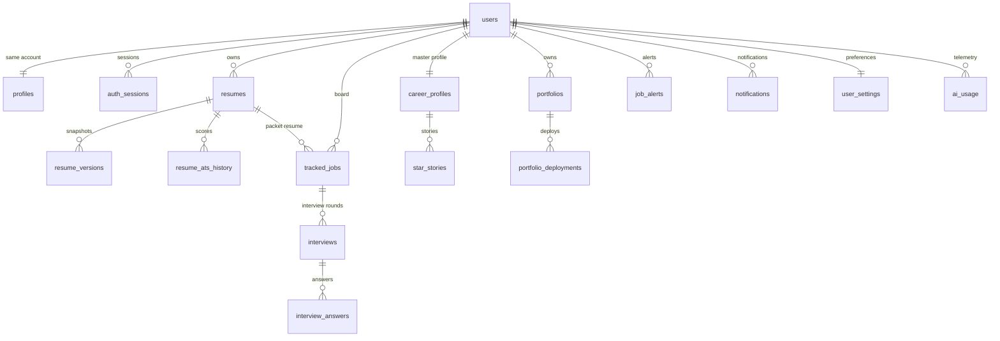

# Database Schema Documentation

**Last updated:** 2026-11-28
**Primary database:** Cloudflare D1 (`careerpilot-db`, SQLite dialect)
**Schema source of truth:** `worker/migrations/*.sql`

Career Pilot's live data layer is Cloudflare D1, accessed through the gateway
Worker (`worker/src/db.js`) at `/v1/db/*`. The SQL below is what the application
actually creates; this document mirrors it table by table.

> **Legacy.** The repository also contains `supabase/migrations/*.sql` (Postgres)
> and Mongoose models in `backend/src/models/` used by the optional Express
> backend. They are documented at the end and are **not** used by the D1 core.

---

## Table of Contents

- [Conventions](#conventions)
- [Migration Workflow](#migration-workflow)
- [Identity & Auth](#identity--auth)
- [Resumes](#resumes)
- [Jobs & Applications](#jobs--applications)
- [Portfolios](#portfolios)
- [Career & Interviews](#career--interviews)
- [Platform & Telemetry](#platform--telemetry)
- [Community](#community)
- [Entity Relationships](#entity-relationships)
- [Access Patterns & Security](#access-patterns--security)
- [Legacy Schemas](#legacy-schemas)

---

## Conventions

| Convention | Detail |
|---|---|
| Engine | SQLite / Cloudflare D1 |
| Primary keys | `TEXT` UUIDs generated in the Worker (`crypto.randomUUID()`), except `ai_usage.id` (autoincrement) and `user_settings.user_id` |
| Timestamps | `TEXT` ISO-8601; defaults use `datetime('now')` |
| Booleans | `INTEGER` 0/1 (`is_public`, `is_admin`, `revoked`, `byok`, …) |
| JSON | Stored as `TEXT` (SQLite JSON1 strings), read/written with `JSON.parse`/`JSON.stringify` in `worker/src/db.js` |
| Ownership | Every user-owned table has `user_id TEXT NOT NULL`; queries always add `WHERE user_id = ?` |
| Extensibility | Most feature tables have a `data TEXT DEFAULT '{}'` column that preserves the original camelCase document shape |
| Public reads | `resumes.share_token`, `resume_roasts.share_token`, `portfolios.slug` + `is_public` |

---

## Migration Workflow

```bash
cd worker

# Apply to the local D1 used by `wrangler dev`
npx wrangler d1 migrations apply DB --local

# Apply to the production D1 (CI does this automatically before deploy)
npx wrangler d1 migrations apply DB --remote

# Inspect
npx wrangler d1 execute DB --local --command "SELECT name FROM sqlite_master WHERE type='table'"
```

Migrations are additive, ordered files:

| File | Purpose |
|---|---|
| `0001_initial_schema.sql` | `users`, `resumes`, `tracked_jobs`, `files`, `ai_usage` |
| `0002_unified_d1_platform.sql` | Adds native auth, profiles, every feature table and `ai_usage` telemetry columns |

CI runs `npx wrangler d1 migrations apply DB --remote` before `wrangler deploy`,
so the schema is ahead of the Worker code.

---

## Identity & Auth

### `users`

Base (0001) + auth columns (0002).

| Column | Type | Default | Notes |
|---|---|---|---|
| `id` | TEXT | — | PK, UUID |
| `email` | TEXT | — | UNIQUE |
| `name` | TEXT | — | Display name |
| `avatar_url` | TEXT | — | ImageKit/remote URL |
| `password_hash` | TEXT | — | `pbkdf2$100000$salt$hash` |
| `username` | TEXT | — | Optional handle |
| `is_admin` | INTEGER | 0 | Admin flag used by the UI/Express |
| `email_verified` | INTEGER | 1 | OAuth users default verified |
| `auth_provider` | TEXT | `email` | `email`, `google`, `github` |
| `provider_id` | TEXT | — | OAuth subject |
| `last_login_at` | TEXT | — | Updated on login |
| `created_at`, `updated_at` | TEXT | `datetime('now')` | |

Indexes: `idx_users_email`.

### `profiles`

| Column | Type | Default | Notes |
|---|---|---|---|
| `id` | TEXT | — | PK |
| `username` | TEXT | — | |
| `email` | TEXT | — | UNIQUE NOT NULL |
| `full_name` | TEXT | — | |
| `avatar_url` | TEXT | — | |
| `job_role` | TEXT | `''` | |
| `years_of_experience` | INTEGER | 0 | |
| `skills` | TEXT | `'[]'` | JSON array |
| `bio` | TEXT | `''` | |
| `is_admin` | INTEGER | 0 | |
| `preferences` | TEXT | `{"jobAlerts":true,"directMessages":true,"proposalUpdates":true}` | JSON |
| `github_username`, `linkedin_url`, `headline`, `location`, `website` | TEXT | `''` | |
| `plan` | TEXT | `free` | |
| `is_pro` | INTEGER | 0 | |
| `data` | TEXT | `'{}'` | Extra profile fields |
| `created_at`, `updated_at` | TEXT | `datetime('now')` | |

Index: `idx_profiles_email`.

### `auth_sessions`

| Column | Type | Notes |
|---|---|---|
| `id` | TEXT | PK |
| `user_id` | TEXT | NOT NULL |
| `token_jti` | TEXT | NOT NULL UNIQUE — matches the JWT `jti` |
| `expires_at` | TEXT | NOT NULL |
| `revoked` | INTEGER | 0/1 |
| `created_at` | TEXT | |

Indexes: `idx_auth_sessions_user`, `idx_auth_sessions_jti`.

### `oauth_states`

| Column | Type | Notes |
|---|---|---|
| `state` | TEXT | PK — random state |
| `provider` | TEXT | `google` or `github` |
| `redirect_to` | TEXT | Frontend path, default `/dashboard` |
| `expires_at` | TEXT | 10-minute TTL |
| `created_at` | TEXT | |

---

## Resumes

### `resumes`

| Column | Type | Default | Notes |
|---|---|---|---|
| `id` | TEXT | — | PK |
| `user_id` | TEXT | — | NOT NULL |
| `title` | TEXT | — | NOT NULL |
| `original_text` | TEXT | — | NOT NULL, raw import |
| `enhanced_text` | TEXT | — | AI-enhanced version |
| `job_role` | TEXT | — | |
| `ats_score` | REAL | — | Last score |
| `pdf_url` | TEXT | — | ImageKit PDF |
| `preferences_json` | TEXT | — | Layout/preferences |
| `target_role` | TEXT | `''` | |
| `personal_info` | TEXT | `'{}'` | JSON |
| `summary` | TEXT | `''` | |
| `experience` | TEXT | `'[]'` | JSON |
| `education` | TEXT | `'[]'` | JSON |
| `skills` | TEXT | `'[]'` | JSON |
| `projects` | TEXT | `'[]'` | JSON |
| `certifications` | TEXT | `'[]'` | JSON |
| `template` | TEXT | `classic` | Resume template id |
| `is_public` | INTEGER | 0 | |
| `share_token` | TEXT | — | UNIQUE when set |
| `source` | TEXT | `manual` | `manual`, `upload`, `text`, … |
| `data` | TEXT | `'{}'` | Full document |
| `created_at`, `updated_at` | TEXT | `datetime('now')` | |

Indexes: `idx_resumes_user`, `idx_resumes_share_token` (partial UNIQUE),
`idx_resumes_updated (user_id, updated_at DESC)`.

### `resume_versions`

| Column | Type | Default | Notes |
|---|---|---|---|
| `id` | TEXT | — | PK |
| `resume_id` | TEXT | — | NOT NULL |
| `user_id` | TEXT | — | NOT NULL |
| `version_label` | TEXT | `Snapshot` | |
| `data` | TEXT | `'{}'` | Snapshot of the resume document |
| `created_at` | TEXT | `datetime('now')` | |

Indexes: `idx_resume_versions_resume (resume_id, created_at DESC)`, `idx_resume_versions_user`.

### `resume_ats_history`

| Column | Type | Default | Notes |
|---|---|---|---|
| `id` | TEXT | — | PK |
| `resume_id` | TEXT | — | NOT NULL |
| `user_id` | TEXT | — | NOT NULL |
| `score` | INTEGER | 0 | ATS score |
| `data` | TEXT | `'{}'` | Breakdown |
| `created_at` | TEXT | `datetime('now')` | |

Index: `idx_resume_ats_resume (resume_id, created_at DESC)`.

### `resume_roasts`

| Column | Type | Default | Notes |
|---|---|---|---|
| `id` | TEXT | — | PK |
| `user_id` | TEXT | — | NOT NULL |
| `resume_text` | TEXT | `''` | |
| `job_role` | TEXT | `''` | |
| `roast` | TEXT | `'{}'` | Structured roast result |
| `is_public` | INTEGER | 0 | Enables share route |
| `share_token` | TEXT | — | UNIQUE |
| `data` | TEXT | `'{}'` | |
| `created_at`, `updated_at` | TEXT | `datetime('now')` | |

Indexes: `idx_resume_roasts_user`, `idx_resume_roasts_share`.

### `cover_letters`

| Column | Type | Default | Notes |
|---|---|---|---|
| `id` | TEXT | — | PK |
| `user_id` | TEXT | — | NOT NULL |
| `resume_id` | TEXT | — | Optional link |
| `job_title`, `company` | TEXT | `''` | |
| `tone` | TEXT | `professional` | |
| `content` | TEXT | `''` | NOT NULL |
| `data` | TEXT | `'{}'` | |
| `created_at` | TEXT | `datetime('now')` | |

Index: `idx_cover_letters_user`.

---

## Jobs & Applications

### `tracked_jobs`

The job board's source of truth. Base (0001) + application-packet columns (0002).

| Column | Type | Default | Notes |
|---|---|---|---|
| `id` | TEXT | — | PK |
| `user_id` | TEXT | — | NOT NULL |
| `company` | TEXT | — | NOT NULL |
| `title` | TEXT | — | NOT NULL |
| `location` | TEXT | — | |
| `status` | TEXT | `saved` | `saved`, `applied`, `interviewing`, `offer`, `rejected`, … |
| `salary` | TEXT | — | |
| `job_url` | TEXT | — | |
| `notes` | TEXT | — | Latest note text |
| `raw_data` | TEXT | — | Original listing payload |
| `job_id` | TEXT | — | Idempotency key (`company::title` or provider id) |
| `applied_date` / `applied_at` | TEXT | — | Set when status becomes applied |
| `position` | INTEGER | — | Kanban ordering |
| `resume_id`, `resume_version_id` | TEXT | — | Packet references |
| `cover_letter_id`, `interview_id` | TEXT | — | Packet references |
| `next_action_at` | TEXT | — | Follow-up due date (indexed) |
| `next_action_type` | TEXT | — | `follow_up`, `thank_you`, `prep`, … |
| `interview_at` | TEXT | — | |
| `last_activity_at` | TEXT | — | |
| `packet` | TEXT | `'{}'` | Application packet JSON |
| `offer` | TEXT | `'{}'` | Offer details |
| `rejection` | TEXT | `'{}'` | Rejection details |
| `data` | TEXT | `'{}'` | Full document |
| `created_at`, `updated_at` | TEXT | `datetime('now')` | |

Indexes: `idx_tracked_jobs_user`, `idx_tracked_jobs_status`,
`idx_tracked_jobs_user_updated (user_id, updated_at DESC)`,
`idx_tracked_jobs_user_job (user_id, job_id)`,
`idx_tracked_jobs_due (user_id, next_action_at)`.

See [APPLICATION_PACKETS.md](APPLICATION_PACKETS.md) for the packet/calendar
workflow.

### `job_listings`

Shared search results cache (not user-owned).

| Column | Type | Default |
|---|---|---|
| `id` | TEXT | — |
| `title`, `company` | TEXT | NOT NULL |
| `location` | TEXT | `Remote` |
| `job_type` | TEXT | `Full-time` |
| `experience_level` | TEXT | `Mid` |
| `salary_min`, `salary_max` | REAL | — |
| `currency` | TEXT | `USD` |
| `description` | TEXT | `''` |
| `requirements`, `skills` | TEXT | `'[]'` |
| `source` | TEXT | `manual` |
| `apply_url` | TEXT | — |
| `created_at`, `updated_at` | TEXT | `datetime('now')` |

### `job_alerts`

| Column | Type | Default | Notes |
|---|---|---|---|
| `id` | TEXT | — | PK |
| `user_id` | TEXT | — | NOT NULL |
| `email` | TEXT | `''` | Delivery address |
| `keywords` | TEXT | `'[]'` | JSON |
| `location` | TEXT | `''` | |
| `experience_level` | TEXT | `''` | |
| `min_salary` | REAL | 0 | |
| `frequency` | TEXT | `daily` | |
| `is_active` | INTEGER | 1 | |
| `last_run_at` | TEXT | — | |
| `matched_count` | INTEGER | 0 | |
| `data` | TEXT | `'{}'` | |
| `created_at`, `updated_at` | TEXT | `datetime('now')` | |

Index: `idx_job_alerts_user`.

---

## Portfolios

### `portfolios`

| Column | Type | Default | Notes |
|---|---|---|---|
| `id` | TEXT | — | PK |
| `user_id` | TEXT | — | NOT NULL |
| `slug` | TEXT | — | NOT NULL; UNIQUE per user |
| `template_id` | TEXT | `default` | One of 262 template ids |
| `title` | TEXT | — | |
| `sections_json` | TEXT | — | Structured content |
| `deployed_url` | TEXT | — | Last deploy URL |
| `project_name` | TEXT | — | Deploy target name |
| `data` | TEXT | `'{}'` | Full portfolio document |
| `theme` | TEXT | `'{}'` | Theme tokens |
| `is_public` | INTEGER | 0 | Public slug reads |
| `deploy_provider` | TEXT | — | `cloudflare`, `netlify`, `github-pages` |
| `deployed_at` | TEXT | — | |
| `created_at`, `updated_at` | TEXT | `datetime('now')` | |

Indexes: `idx_portfolios_user_slug` (UNIQUE), `idx_portfolios_user`,
`idx_portfolios_slug`.

### `portfolio_deployments`

| Column | Type | Default | Notes |
|---|---|---|---|
| `id` | TEXT | — | PK |
| `user_id` | TEXT | — | NOT NULL |
| `portfolio_id` | TEXT | — | |
| `provider` | TEXT | `cloudflare` | |
| `url` | TEXT | — | |
| `status` | TEXT | `success` | |
| `logs` | TEXT | `'[]'` | JSON |
| `created_at` | TEXT | `datetime('now')` | |

Index: `idx_portfolio_deployments_user`.

### `github_portfolio_builds`

| Column | Type | Default |
|---|---|---|
| `id` | TEXT | — |
| `user_id` | TEXT | NOT NULL |
| `username` | TEXT | `''` |
| `template_slug` | TEXT | `''` |
| `repos` | TEXT | `'[]'` |
| `data` | TEXT | `'{}'` |
| `is_public` | INTEGER | 0 |
| `created_at` | TEXT | `datetime('now')` |

Index: `idx_gh_builds_user`.

---

## Career & Interviews

### `career_profiles`

| Column | Type | Default | Notes |
|---|---|---|---|
| `id` | TEXT | — | PK |
| `user_id` | TEXT | — | NOT NULL UNIQUE |
| `master_resume_id` | TEXT | — | |
| `master_resume_text` | TEXT | `''` | Scored by the extension |
| `target_roles` | TEXT | `'[]'` | JSON |
| `weekly_apply_target` | INTEGER | 5 | |
| `data` | TEXT | `'{}'` | |
| `created_at`, `updated_at` | TEXT | `datetime('now')` | |

### `star_stories`

| Column | Type | Default | Notes |
|---|---|---|---|
| `id` | TEXT | — | PK |
| `user_id` | TEXT | — | NOT NULL |
| `title` | TEXT | `''` | |
| `situation`, `task`, `action`, `result` | TEXT | `''` | STAR fields |
| `skills` | TEXT | `'[]'` | JSON |
| `role_tags` | TEXT | `'[]'` | JSON |
| `source` | TEXT | `manual` | |
| `tracked_job_id` | TEXT | — | Optional link |
| `data` | TEXT | `'{}'` | |
| `created_at`, `updated_at` | TEXT | `datetime('now')` | |

Index: `idx_star_stories_user`.

### `interviews`

| Column | Type | Default | Notes |
|---|---|---|---|
| `id` | TEXT | — | PK |
| `user_id` | TEXT | — | NOT NULL |
| `job_role` | TEXT | `''` | |
| `industry` | TEXT | `''` | |
| `difficulty` | TEXT | `mid` | |
| `interview_type` | TEXT | `behavioral` | |
| `language` | TEXT | `en` | |
| `status` | TEXT | `in_progress` | |
| `questions` | TEXT | `'[]'` | JSON |
| `overall_feedback` | TEXT | — | |
| `tracked_job_id` | TEXT | — | Application link |
| `next_status_suggestion` | TEXT | — | |
| `company_name` | TEXT | `''` | |
| `data` | TEXT | `'{}'` | |
| `created_at`, `completed_at`, `updated_at` | TEXT | `datetime('now')` | |

Indexes: `idx_interviews_user`, `idx_interviews_job`.

### `interview_answers`

| Column | Type | Default |
|---|---|---|
| `id` | TEXT | — |
| `interview_id` | TEXT | NOT NULL |
| `user_id` | TEXT | NOT NULL |
| `question_id` | TEXT | — |
| `transcript` | TEXT | `''` |
| `code` | TEXT | `''` |
| `feedback` | TEXT | — |
| `duration` | INTEGER | 0 |
| `data` | TEXT | `'{}'` |
| `created_at` | TEXT | `datetime('now')` |

Index: `idx_interview_answers_session`.

### `outreach_records`

| Column | Type | Default |
|---|---|---|
| `id` | TEXT | — |
| `user_id` | TEXT | NOT NULL |
| `company_url`, `company_name` | TEXT | `''` |
| `status` | TEXT | `drafted` |
| `drafts` | TEXT | `'{}'` |
| `data` | TEXT | `'{}'` |
| `created_at`, `updated_at` | TEXT | `datetime('now')` |

Index: `idx_outreach_user`.

---

## Platform & Telemetry

### `notifications`

| Column | Type | Default |
|---|---|---|
| `id` | TEXT | — |
| `user_id` | TEXT | NOT NULL |
| `type` | TEXT | `info` |
| `title` | TEXT | `''` |
| `body`, `link` | TEXT | `''` |
| `read` | INTEGER | 0 |
| `data` | TEXT | `'{}'` |
| `created_at` | TEXT | `datetime('now')` |

Index: `idx_notifications_user`.

### `user_settings`

One row per user (`user_id` is the PK).

| Column | Type | Default |
|---|---|---|
| `user_id` | TEXT | — (PK) |
| `ai` | TEXT | `'{}'` |
| `github` | TEXT | `'{}'` |
| `notifications` | TEXT | `'{}'` |
| `theme` | TEXT | `dark` |
| `data` | TEXT | `'{}'` |
| `created_at`, `updated_at` | TEXT | `datetime('now')` |

### `ai_usage`

Telemetry written by the gateway after every successful AI call.

| Column | Type | Default | Notes |
|---|---|---|---|
| `id` | INTEGER | autoincrement | PK |
| `user_id` | TEXT | — | `anonymous` when unauthenticated |
| `provider` | TEXT | — | |
| `model` | TEXT | — | |
| `prompt_tokens`, `completion_tokens` | INTEGER | 0 | |
| `feature` | TEXT | `unknown` | From `X-Feature` |
| `input_tokens`, `output_tokens` | INTEGER | 0 | Normalized aliases |
| `latency_ms` | INTEGER | 0 | |
| `byok` | INTEGER | 0 | 1 when a user key was used |
| `created_at` | TEXT | `datetime('now')` | |

Index: `idx_ai_usage_user`.

### `files`

| Column | Type | Default | Notes |
|---|---|---|---|
| `id` | TEXT | — | PK |
| `user_id` | TEXT | — | |
| `file_id` | TEXT | — | ImageKit file id |
| `file_name`, `file_url` | TEXT | — | |
| `file_type` | TEXT | `file` | |
| `size` | INTEGER | 0 | |
| `created_at` | TEXT | `datetime('now')` | |

Index: `idx_files_user`.

### `user_inputs`

Resume-builder intake payloads.

| Column | Type | Default |
|---|---|---|
| `id` | TEXT | — |
| `user_id` | TEXT | NOT NULL |
| `name`, `job_role` | TEXT | — |
| `experience_level` | TEXT | `Entry` |
| `tech_skills`, `soft_skills` | TEXT | `'[]'` |
| `resume_url`, `resume_text` | TEXT | — |
| `created_at` | TEXT | `datetime('now')` |

### `recruiter_analysis`

| Column | Type | Default |
|---|---|---|
| `id` | TEXT | — |
| `user_id` | TEXT | NOT NULL |
| `username`, `email` | TEXT | NOT NULL |
| `resume_url` | TEXT | — |
| `match_percentage` | INTEGER | 0 |
| `job_title` | TEXT | `Software Developer` |
| `created_at`, `updated_at` | TEXT | `datetime('now')` |

Unique index: `idx_recruiter_user_job (user_id, job_title)`.

---

## Community

Schema is present in D1 for the planned realtime port; the live Community page
currently uses the Express/Appwrite controller.

### `community_posts`

| Column | Type | Default |
|---|---|---|
| `id` | TEXT | — |
| `author_id` | TEXT | NOT NULL |
| `author_name` | TEXT | `Anonymous` |
| `author_avatar` | TEXT | — |
| `title`, `content` | TEXT | NOT NULL |
| `channel_id` | TEXT | `general` |
| `tags` | TEXT | `'[]'` |
| `likes` | TEXT | `'[]'` |
| `views` | TEXT | `'[]'` |
| `comments_count` | INTEGER | 0 |
| `created_at`, `updated_at` | TEXT | `datetime('now')` |

### `community_comments`

| Column | Type | Default |
|---|---|---|
| `id` | TEXT | — |
| `post_id` | TEXT | NOT NULL |
| `author_id` | TEXT | NOT NULL |
| `author_name` | TEXT | `Anonymous` |
| `author_avatar` | TEXT | — |
| `content` | TEXT | NOT NULL |
| `likes` | TEXT | `'[]'` |
| `created_at` | TEXT | `datetime('now')` |

Index: `idx_community_comments_post`.

---

## Entity Relationships



Relationships are logical (no enforced foreign keys in D1); the Worker and
frontend maintain them by id.

---

## Access Patterns & Security

| Operation | SQL shape | Auth |
|---|---|---|
| List tool data | `SELECT … WHERE user_id = ? ORDER BY updated_at DESC` | Bearer JWT |
| Read one | `SELECT … WHERE id = ? AND user_id = ?` | Bearer JWT |
| Update | `UPDATE … SET … WHERE id = ? AND user_id = ?` | Bearer JWT |
| Delete | `DELETE … WHERE id = ? AND user_id = ?` | Bearer JWT |
| Public resume | `SELECT … WHERE share_token = ?` | none (opt-in) |
| Public roast | `SELECT … WHERE share_token = ?` | none (opt-in) |
| Public portfolio | `SELECT … WHERE slug = ?` (prefers `is_public = 1`, currently falls back to any row) | none (slug is the capability) |
| AI ledger | `INSERT INTO ai_usage …` | best effort |

All scoping happens in `worker/src/db.js`; every route resolves the authenticated
user through `authenticateRequest` first. Regression tests in
`worker/test/` cover cross-tenant delete/update attempts.

---

## Legacy Schemas

### Supabase Postgres (`supabase/migrations/`)

| File | Tables |
|---|---|
| `20261105000000_init_supabase.sql` | `profiles`, `resumes`, `job_listings`, `tracked_jobs`, `job_alerts`, `community_posts`, `community_comments`, `user_inputs`, `recruiter_analysis` |
| `20261114000000_unified_platform.sql` | `portfolios`, `portfolio_deployments`, `resume_versions`, `resume_ats_history`, `resume_roasts`, `cover_letters`, `interviews`, `interview_answers`, `github_portfolio_builds`, `outreach_records`, `ai_usage`, `notifications`, `user_settings` |
| `20261115000000_application_packets.sql` | `career_profiles`, `star_stories` + packet columns on `tracked_jobs` |

These applied Row-Level Security with `auth.uid() = user_id`. They are retained
for deployments that have not migrated; new work targets D1.

### MongoDB (`backend/src/models/`)

The optional Express backend keeps Mongoose models for the features it still
serves: users, resumes, portfolios, tracked jobs, job alerts, interviews,
community/fellowship, payments, admin, GitHub intel. The backend can read D1
through `backend/src/config/d1.js` (gateway or REST) and accepts D1 JWTs, but
its primary store remains MongoDB for those routes.

### Firebase

`firebase/` contains rules and indexes from an earlier iteration. No runtime
code depends on them; they can be deleted once the repo no longer needs them.
