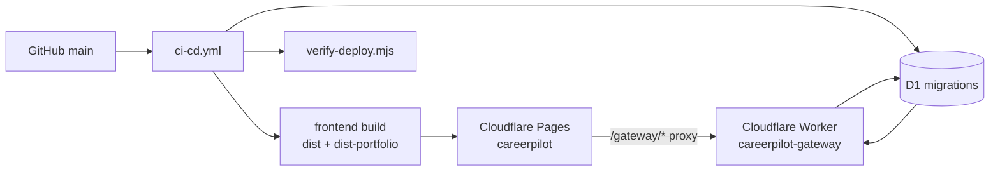

# 🚀 Deployment Guide

> **Last updated:** 2026-11-28
>
> **Live path:** Cloudflare Pages (SPA) + Cloudflare Worker (gateway) + Cloudflare D1.
> The Express backend is optional and is **not** part of the automated deploy.

---

## 🌐 Deployment Topology



| Piece | Name | Config |
|---|---|---|
| SPA | Pages project `careerpilot` | `frontend/dist`, build `npm run build` |
| Gateway | Worker `careerpilot-gateway` | `worker/wrangler.toml` |
| Database | D1 `careerpilot-db` | `worker/migrations/`, binding `DB` |
| AI | Workers AI binding `AI` | `worker/wrangler.toml` |

The public origin must expose `/gateway/*` for the Worker. That is configured
**outside this repository** as a Worker route on a custom domain (for example
`careerpilot.app/gateway/*` → `careerpilot-gateway`). The SPA builds with
`VITE_AI_GATEWAY_URL=/gateway/v1`, so same-origin routing is the default.

---

## ⚡ Automated Path (primary)

`.github/workflows/ci-cd.yml` runs on every PR and push to `main`:

1. **frontend** — `npm ci --legacy-peer-deps`, lint, Vitest, `npm run build`
   (SPA + standalone portfolio shell). Uploads `frontend-dist` and
   `portfolio-shell` artifacts.
2. **backend** — restores `portfolio-shell`, installs, lints, `npm test`
   (Node test runner).
3. **worker** — installs, `npm test` (`node --test`, in-memory D1).
4. **deploy** — runs only on `main` (or manual dispatch with `deploy: true`)
   after all three jobs pass:
   ```bash
   npx wrangler d1 migrations apply DB --remote
   npx wrangler deploy
   wrangler pages deploy frontend/dist --project-name=careerpilot --branch=main
   node scripts/verify-deploy.mjs
   ```

### Repository secrets and variables

| Name | Kind | Purpose |
|---|---|---|
| `CLOUDFLARE_API_TOKEN` | Secret | Workers Scripts: Edit, Pages: Edit, D1: Edit |
| `CLOUDFLARE_ACCOUNT_ID` | Secret | Account id |
| `PAGES_URL` | Variable (optional) | Smoke-test Pages URL |
| `WORKER_URL` | Variable (optional) | Smoke-test Worker URL |
| `PUBLIC_SITE_URL` | Variable (optional) | Non-blocking `/gateway/v1/health` check |

Default smoke-test URLs (fallbacks in `scripts/verify-deploy.mjs`):
`https://careerpilot-20i.pages.dev` and
`https://careerpilot-gateway.anuragmishra3407.workers.dev`.

CI runs on Node 22 (`.nvmrc`, `NODE_VERSION`).

---

## ☁️ Manual Runbook (Cloudflare)

> Each command block below starts from the repository root.

### 1. Create/verify D1

```bash
cd worker
npx wrangler d1 create careerpilot-db      # first time only
# copy the database_id into wrangler.toml if it changed
npx wrangler d1 migrations apply DB --remote
```

### 2. Set Worker secrets

```bash
cd worker
npx wrangler secret put AUTH_SECRET          # required
npx wrangler secret put GEMINI_API_KEY       # optional providers
npx wrangler secret put OPENAI_API_KEY
npx wrangler secret put GROQ_API_KEY
npx wrangler secret put OPENROUTER_API_KEY
npx wrangler secret put ANTHROPIC_API_KEY
npx wrangler secret put RAPIDAPI_KEY         # job search
npx wrangler secret put IMAGEKIT_PRIVATE_KEY # uploads
# OAuth (optional)
npx wrangler secret put GOOGLE_CLIENT_ID
npx wrangler secret put GOOGLE_CLIENT_SECRET
npx wrangler secret put GITHUB_CLIENT_ID
npx wrangler secret put GITHUB_CLIENT_SECRET
```

### 3. Deploy the Worker

```bash
cd worker
npx wrangler deploy
curl -s https://careerpilot-gateway.<subdomain>.workers.dev/v1/health
```

### 4. Build and deploy Pages

```bash
cd frontend
VITE_AI_GATEWAY_URL=/gateway/v1 npm run build
npx wrangler pages deploy dist --project-name=careerpilot --branch=main
```

Or connect the repo in the Pages dashboard:

| Setting | Value |
|---|---|
| Root directory | `frontend` |
| Build command | `npm run build` |
| Build output | `dist` |
| Env | `VITE_AI_GATEWAY_URL=/gateway/v1` (and `VITE_API_BASE` if using Express) |

`frontend/public/_redirects` supplies the SPA fallback; `_headers` sets caching
and security headers.

### 5. Verify

```bash
PAGES_URL=https://careerpilot-20i.pages.dev \
WORKER_URL=https://careerpilot-gateway.<subdomain>.workers.dev \
node scripts/verify-deploy.mjs
```

The script checks the Pages bundle hash and Worker `/v1/health` (D1 ready).

---

## 🔁 Alternative Static Hosts

The SPA is static, but **any host must proxy `/gateway/*` to the Worker** (or you
must build with an absolute `VITE_AI_GATEWAY_URL` and configure Worker CORS).

| Host | Notes |
|---|---|
| **Netlify** | Build `npm run build`, publish `frontend/dist`; `frontend/netlify.toml` exists. Add a `/gateway/*` redirect to the Worker. |
| **Vercel** | `frontend/vercel.json` exists; build Vite preset, output `dist`. Add a rewrite for `/gateway/*`. |
| **GitHub Pages** | Static only; requires an absolute Worker URL and Worker CORS, or an external proxy. |
| **Self-hosted nginx** | `frontend/nginx.conf` exists; proxy `/gateway/` to the Worker. |

Without the `/gateway` proxy, auth/CRUD/AI calls 404 (the smoke test warns when
`PUBLIC_SITE_URL/gateway/v1/health` is unreachable).

---

## 🧰 Optional Express Backend

Deploy only if you need PDF rendering, portfolio deploys, community/fellowship,
payments, admin or queues.

| Item | Detail |
|---|---|
| Build | `backend/Dockerfile` (Node 22) or `npm ci && node src/index.js` |
| Port | `PORT` (default 5000) |
| Health | `GET /health` |
| Required env | `NODE_ENV=production`, `FRONTEND_URL`, `MONGODB_URI`, `REDIS_URL`, `AUTH_SECRET` (or `CLOUDFLARE_D1_GATEWAY_URL` for remote verification) |
| Recommended hosts | Render, Railway, Fly.io, any Docker host |
| Frontend wiring | Set `VITE_API_URL`/`VITE_API_BASE` at build time and proxy `/api/*` in the static host |

The backend accepts D1 JWTs, so users authenticate once through the gateway and
the Express API trusts the same bearer token.

Legacy configs (`backend/vercel.json`, `backend/netlify.toml`) exist from
earlier experiments but are not maintained by CI.

---

## 🎨 User Portfolio Deploys

Separate from hosting the product: users deploy their generated portfolios
through the Express backend.

| Provider | Service |
|---|---|
| Cloudflare Pages | `backend/src/services/deploy/cloudflareDeployer.js` |
| Netlify | `backend/src/services/deploy/netlifyDeployer.js` |
| GitHub Pages | `backend/src/services/deploy/githubPagesDeployer.js` |

Each requires the user's provider token (validated before deploy) and reads the
standalone shell at `frontend/dist-portfolio/standalone.html`. Results are
recorded in D1 `portfolio_deployments`.

---

## ✅ Post-Deployment Checklist

- [ ] `GET /v1/health` returns `ok: true` and `d1: true`
- [ ] Signup/login works and `/v1/auth/me` returns the user
- [ ] D1 tables exist (health reports the table count)
- [ ] `/gateway/v1/health` is reachable from the public origin
- [ ] `scripts/verify-deploy.mjs` passes
- [ ] SPA routes survive a hard refresh (`_redirects` working)
- [ ] AI generate returns text (platform or BYOK)
- [ ] Job search works when `RAPIDAPI_KEY` is set
- [ ] ImageKit signature/upload works when configured
- [ ] OAuth callbacks land on `/auth/callback`
- [ ] No secrets in the browser bundle or network payloads

## ↩️ Rollback

- **Worker:** `npx wrangler rollback` (or redeploy the previous commit).
- **Pages:** redeploy the previous commit's `frontend/dist`, or promote a prior
  deployment in the Pages dashboard.
- **D1:** migrations are additive; to undo a schema change, write a new forward
  migration rather than editing history. Take a D1 export before destructive
  changes.

> [!CAUTION]
> Never expose backend secrets through `VITE_*` variables. Only the gateway URL
> and optional Express base URL belong in the frontend build.
