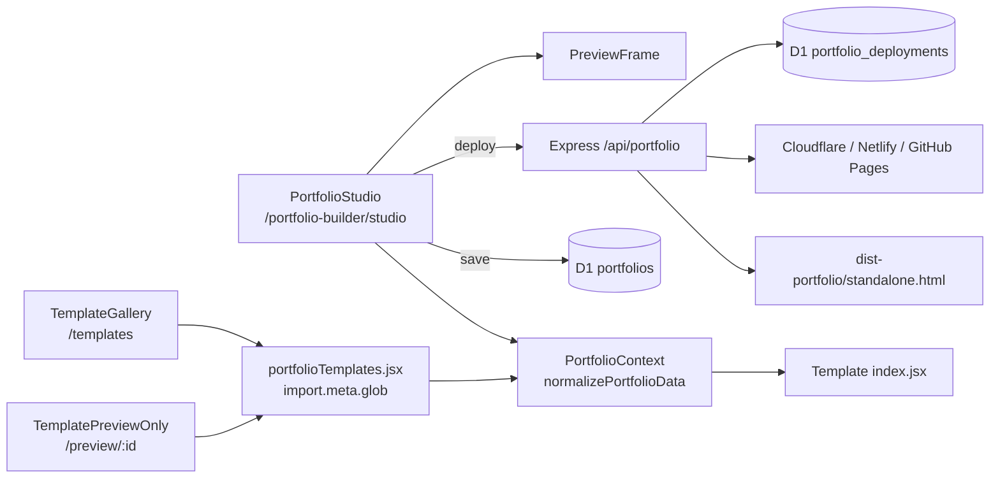

# 🎨 Portfolio Feature Architecture

**Last updated:** 2026-11-28
**Audience:** developers and contributors
**Status:** active

---

## Table of Contents

1. [Overview](#1-overview)
2. [Components](#2-components)
3. [Data Model](#3-data-model)
4. [Template System](#4-template-system)
5. [Studio & Preview](#5-studio--preview)
6. [Standalone Bundle](#6-standalone-bundle)
7. [Deployment](#7-deployment)
8. [Public Routes](#8-public-routes)
9. [GitHub Project Sync](#9-github-project-sync)
10. [API Endpoints](#10-api-endpoints)
11. [Adding a Template](#11-adding-a-template)
12. [Adding a Deploy Provider](#12-adding-a-deploy-provider)
13. [Security & No-Dummy-Data](#13-security--no-dummy-data)
14. [Testing](#14-testing)

---

## 1. Overview

The portfolio system has two halves:

| Half | Runs on | Responsibility |
|---|---|---|
| Authoring | Frontend (Cloudflare Pages) | 262 React templates, gallery, preview, Studio editor, content/data normalization |
| Publishing | Optional Express backend | Token validation, HTML bundle generation, provider deploy, public metadata |

Portfolio **content** is stored in D1 (`portfolios`); deploy **history** is
stored in D1 (`portfolio_deployments`). The Express backend still owns the
actual provider API calls and uses the prebuilt standalone shell.

---

## 2. Components



| File | Role |
|---|---|
| `frontend/src/data/templates.js` | Curated metadata list (id, title, image, description…) |
| `frontend/src/data/portfolioTemplates.jsx` | Filesystem registry + lazy components + `STUDIO_TEMPLATE` |
| `frontend/src/context/PortfolioContext.jsx` | Data normalization; demo data isolation |
| `frontend/src/standalone/main.jsx` | Reads `window.__PORTFOLIO_DATA__` and renders the chosen template |
| `frontend/vite.standalone.config.js` | Builds `frontend/dist-portfolio/standalone.html` |
| `backend/src/services/deploy/portfolioHtmlGenerator.js` | Injects content into the shell |
| `backend/src/services/deploy/*Deployer.js` | Provider APIs |
| `backend/src/routes/portfolio.js` | Express endpoints |
| `frontend/src/services/api.js` (`portfolioApi`) | Client calls, including D1 portfolio CRUD |

---

## 3. Data Model

### D1 `portfolios` (authoring + public read)

Key fields: `id`, `user_id`, `slug` (unique per user), `template_id`, `title`,
`sections_json`, `data` (full document), `theme`, `is_public`, `deployed_url`,
`deploy_provider`, `deployed_at`, `created_at`, `updated_at`.

### D1 `portfolio_deployments` (history)

`id`, `user_id`, `portfolio_id`, `provider`, `url`, `status`, `logs`, `created_at`.

### Mongo `Portfolio` (Express deploy path, legacy)

`userId`, `slug`, `sections`, `deployedUrl`, `projectName`, timestamps.
Unique index on `(userId, slug)`.

### D1 `github_portfolio_builds`

`user_id`, `username`, `template_slug`, `repos`, `data`, `is_public`.

---

## 4. Template System

### Discovery

`frontend/src/data/portfolioTemplates.jsx` builds the registry at build time:

```js
const dirModules = import.meta.glob('../components/portfolio/templates/*/index.jsx');
const fileModules = import.meta.glob('../components/portfolio/templates/*.jsx');
```

Folder name = template id. Metadata comes from `frontend/src/data/templates.js`.
The gallery, preview route and Studio switcher all use the same registry, so a
new folder appears everywhere automatically.

### Data contract

Templates call:

```js
const { portfolioData } = usePortfolio();
```

`normalizePortfolioData` produces a stable shape regardless of what the editor
stored:

- `personal {name,title,tagline,bio,location,email,phone,avatar}`
- `hero {title,subtitle,tagline,bio,image}`
- `about {bio}`
- `skills[]` (strings become `{name, level, category}`)
- `projects[]` (`title`, `description`, `techStack`, `image`, `liveUrl`, `githubUrl`)
- `experience[]`, `education[]`, `socials`, `testimonials[]`, `stats`, `contact`

Demo data (`dummy_data.json`) is used **only** for previews with no user
content. In deploy mode (`window.__PORTFOLIO_DATA__` present) or when user
content exists, missing fields render empty.

### Studio template

`STUDIO_TEMPLATE_ID = 'Studio'` is the built-in composable layout used by the
Studio canvas: reorderable/hideable sections, theme controls, on-canvas editing.

---

## 5. Studio & Preview

| Route | Component | Purpose |
|---|---|---|
| `/templates` | `TemplateGallery` | Browse all templates + previews |
| `/preview/:templateId` | `TemplatePreviewOnly` | Render one template full-screen |
| `/portfolio-builder` | `PortfolioBuilderLanding` | Marketing/entry |
| `/portfolio-builder/studio` | `PortfolioStudio` | Protected editor (sections, theme, content) |
| `/portfolio-builder/stage` | `StudioStage` | Canvas rendering |
| `/portfolio-builder/preview` | `StudioPortfolioPreview` | Preview with editor data |

Editing writes to D1 via `portfolioApi` (`/v1/db/portfolios`). The Studio keeps
`templateId`, `sections`, theme tokens and metadata in the portfolio `data`.

---

## 6. Standalone Bundle

`npm run build:portfolio` runs `vite build --config vite.standalone.config.js`
and emits:

```text
frontend/dist-portfolio/
├── standalone.html
└── assets/…
```

The standalone entry (`frontend/src/standalone/main.jsx`) resolves the template
from `window.__TEMPLATE_ID__`, reads content from `window.__PORTFOLIO_DATA__`,
renders it with the same context, and mounts into the shell. This is the only artifact the backend needs to build
a deployed site, which is why CI uploads a slim `portfolio-shell` artifact
(`standalone.html` + `assets/`) for the backend tests.

---

## 7. Deployment

### Flow

1. Studio calls `portfolioApi.deploy({slug, sections, templateId, title, provider, token, accountId})`.
2. Express `POST /api/portfolio/deploy` validates the slug/content and provider.
3. `portfolioHtmlGenerator` loads `frontend/dist-portfolio/standalone.html` and
   injects `window.__PORTFOLIO_DATA__` plus `window.__TEMPLATE_ID__`.
4. The provider deployer publishes the bundle.
5. The frontend records the result in D1 `portfolio_deployments` (and/or the
   Express route updates the Mongo `Portfolio`).

### Providers

| Provider | Deployer | Token validation |
|---|---|---|
| Cloudflare Pages | `cloudflareDeployer.js` | `POST /api/portfolio/validate-token` (`provider: "cloudflare"`) |
| Netlify | `netlifyDeployer.js` | same, `provider: "netlify"` |
| GitHub Pages | `githubPagesDeployer.js` | same, `provider: "github"` |

### Request

```http
POST /api/portfolio/deploy
Authorization: Bearer <d1_jwt>
{
  "slug": "ada-lovelace",
  "sections": { "personal": {…}, "projects": […] },
  "templateId": "Academic_Scholar",
  "title": "Ada Lovelace",
  "provider": "cloudflare",
  "token": "<user provider token>",
  "accountId": "<cloudflare account id>"
}
```

Response includes `success`, the deployed `url`, `provider`, and project/site
metadata returned by the provider.

Rules: slug is `[a-z0-9-]`, ≤ 100 MB free-tier bundle, content validated before
generation, HTML sanitized.

---

## 8. Public Routes

| Endpoint | Purpose |
|---|---|
| `GET /api/portfolio/public/:slug/sitemap.xml` | Sitemap |
| `GET /api/portfolio/public/:slug/robots.txt` | Robots (references the sitemap) |
| `GET /api/portfolio/public/:slug/accessibility` | Accessibility audit report |
| `GET /api/portfolio/:slug/bandwidth` | Bandwidth/size report |
| `GET /v1/db/portfolios?slug=…` | Portfolio JSON for public pages (see security note) |

The frontend public portfolio route renders from the D1 record; deployed sites
are static files on the provider.

---

## 9. GitHub Project Sync

- `backend/src/services/portfolioGitHubSync.js` runs a cron
  (`ENABLE_GITHUB_SYNC_CRON`) to refresh a user's repositories.
- `backend/src/routes/portfolioGithub.js` exposes sync/build endpoints.
- Builds are stored in D1 `github_portfolio_builds` (and Mongo models for the
  Express path).
- The frontend hub is `/github-portfolio/build` and `/hub/portfolio/github`.

---

## 10. API Endpoints

### Express (`/api/portfolio`)

| Method | Path | Auth | Purpose |
|---|---|---|---|
| POST | `/extract-from-resume` | Yes | AI extract portfolio JSON |
| POST | `/generate-from-resume/:resumeId` | Yes | Build from a stored resume |
| POST | `/validate-token` | Yes | Validate Cloudflare/Netlify/GitHub token |
| POST | `/deploy` | Yes | Deploy bundle |
| GET | `/` | No | List public portfolios |
| POST | `/` | Yes | Create portfolio |
| PUT | `/:slug` | Yes | Update by slug |
| POST | `/:id/save` | Yes | Save editor document |
| GET | `/:id/versions` | Yes | Version history |
| POST | `/:id/restore/:versionId` | Yes | Restore version |
| POST | `/ai-edit` | Yes | Prompt → structured patch |
| POST | `/enhance-portfolio-content` | Yes | Section before/after suggestions |
| POST | `/:id/performance` | Yes | Record size/performance metrics |
| GET | `/:slug/bandwidth` | No | Bandwidth report |
| GET | `/public/:slug/sitemap.xml` | No | Sitemap |
| GET | `/public/:slug/robots.txt` | No | Robots |
| GET | `/public/:slug/accessibility` | No | Accessibility report |

### Gateway (`/v1/db`)

| Method | Path | Purpose |
|---|---|---|
| GET/POST | `/portfolios` | List/create |
| GET/PUT/PATCH/DELETE | `/portfolios/:id` | Single resource |
| GET/POST | `/portfolio-deployments` | History/record |
| GET/POST | `/github-builds` | GitHub builds |

---

## 11. Adding a Template

See [creating-portfolio-themes.md](creating-portfolio-themes.md). Summary:

1. Create `frontend/src/components/portfolio/templates/<Id>/index.jsx`.
2. Use `usePortfolio()`; render empty states.
3. Add metadata to `frontend/src/data/templates.js`.
4. Add `frontend/public/template-previews/<Id>.png`.
5. Verify `/templates`, `/preview/<Id>`, Studio, and `npm run build:portfolio`.

---

## 12. Adding a Deploy Provider

1. Add `<provider>Deployer.js` under `backend/src/services/deploy/` with
   `validateToken()` and `deploy()`.
2. Register the validator in the `TOKEN_VALIDATORS` map in
   `backend/src/routes/portfolio.js`.
3. Handle the provider in `POST /api/portfolio/deploy`.
4. Add the provider entry in `frontend/src/components/portfolio/DeployModal.jsx`
   (`PROVIDERS`, token label, docs link).
5. Record deploys with the same provider id in `portfolio_deployments`.
6. Add a test for token validation and a dry-run deploy path.

---

## 13. Security & No-Dummy-Data

- **No dummy data leak:** `normalizePortfolioData` checks
  `window.__PORTFOLIO_DATA__`/user content and never injects sample names,
  photos or testimonials into deployed output. Covered by the studio/deploy
  tests.
- **Sanitization:** `backend/src/utils/htmlSanitizer.js` and the content
  validator strip scripts/event handlers before generation.
- **Slug validation:** `validatePortfolioSlug` enforces `[a-z0-9-]`.
- **Token handling:** provider tokens are used per request, never stored in the
  bundle; token validation is a separate endpoint.
- **Public read caveat:** `GET /v1/db/portfolios?slug=…` currently falls back to
  any matching slug when no public row matches. Treat slugs as public
  identifiers until that fallback is removed (tracked in `ARCHITECTURE.md`).

---

## 14. Testing

```bash
# Frontend
cd frontend
npm test
npm run build:portfolio

# Backend (needs the standalone shell)
cd backend
npm test

# Worker
cd worker
npm test
```

Test coverage lives in `frontend/src/__tests__/` (template registry, studio),
`backend/src/services/deploy/__tests__/` and `backend/tests/` (HTML generator,
deployers), and the worker tests for portfolio CRUD/scoping.
